# 1. 시작하기

## 1.1. 설치(압축 풀기 · 폴더 구성)

설치 프로그램은 없습니다. 압축을 풀면 바로 씁니다(.NET 설치 불필요).

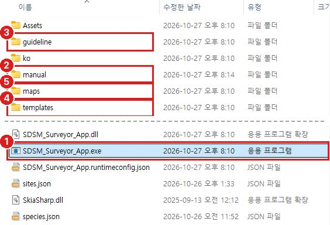

| 번호 | 설명 |
|---|---|
| ① | `SDSM_Surveyor_App.exe` — 프로그램 |
| ② | `manual\` — 이 사용설명서(PDF) |
| ③ | `guideline\` — 지침 원본(PDF) |
| ④ | `templates\` — 일괄입력용 양식 |
| ⑤ | `maps\` — 기본 지도 |

| 파일 · 폴더 | 설명 |
|---|---|
| `manual\` · `guideline\` | 사용설명서 · 지침 원본 PDF · [사용설명서] · [지침 원본 보기] 가 엶 |
| `templates\bulk\` | 일괄입력용 양식 · 없으면 일괄입력용을 만들지 못함 |
| `maps\` | 기본 지도 29장 · 첫 실행 때 자료 폴더로 복사 |
| `species.json` · `sites.json` · `reference.json` | 종목록 · 지점 목록 · 이상치 기준(→ 9장) |
| `ko\` · `*.dll` 등 | 프로그램 파일 · 지우거나 따로 옮기지 않음 |
| `sessions_seed\` · `읽어주세요.txt` | 테스트본에만 · 예시 세션 3건 · 테스트 안내 |

1. 압축 파일 `SDSM_Surveyor_v0.5.2_날짜.zip` 을 원하는 곳에 풉니다.
2. 생긴 폴더 `SDSM_Surveyor_v0.5.2\` 의 `SDSM_Surveyor_App.exe` 를 두 번 누릅니다.

- 압축 파일 안에서 바로 열지 않습니다. 함께 든 양식 · 지도를 읽지 못합니다.
- Windows 가 'PC를 보호했습니다' 창을 띄우면 '추가 정보' → '실행' 을 누릅니다.
- 폴더는 통째로 옮겨도 됩니다. 입력한 자료는 이 폴더에 저장되지 않습니다(→ 1.3).
- 창이 하얗게만 보이면 → 11.1.

## 1.2. 첫 실행 · 담당 분류군 고르기([자료함에서 이어하기] · 다음 실행에도)

처음 켜면 분류군 고르기 창이 뜹니다. 고른 분류군의 야장만 열리고, 다른 분류군은 캡션 바 분류군 칩에서 바꿉니다(→ 2.2).

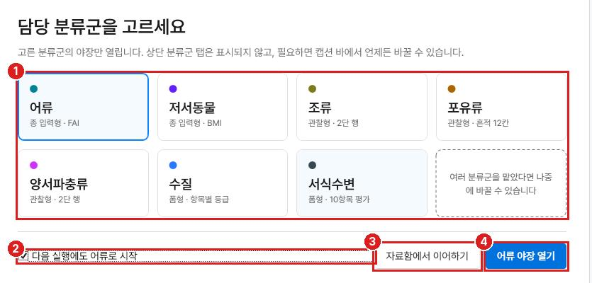

| 번호 | 설명 |
|---|---|
| ① | 분류군 타일 7개 |
| ② | 「다음 실행에도 {분류군}로 시작」 |
| ③ | [자료함에서 이어하기] |
| ④ | [어류 야장 열기] — 고른 분류군 이름이 들어감 |

| 기능 | 설명 |
|---|---|
| 분류군 타일 | 7개 중 하나 · 처음엔 지난번 분류군(없으면 어류) |
| 「다음 실행에도 {분류군}로 시작」 | 켜고 들어가면 다음부터 이 창 없이 바로 야장 |
| [어류 야장 열기] | 고른 분류군으로 야장 열기 · **Enter** |
| [자료함에서 이어하기] | [자료함] 창에서 세션을 [불러오기] · [지점 복사] · [차수 복제] 하면 바로 야장 |
| [정보] | [프로그램 정보] 창(→ 10장) |
| 창 닫기(×) | 프로그램을 끝냄 |

- 메인 창에는 압정 값이 들어 있습니다(→ 3.3). 오류 복구본이 있으면 [복구본이 있습니다] 창이 뜹니다(→ 7.7).
- 이 창을 다시 보려면 분류군 칩의 「다음 실행에도 이 분류군으로 시작」 을 끕니다.

## 1.3. 자료 저장 위치(%AppData%\SDSM_Surveyor)

입력한 자료와 설정은 `%AppData%\SDSM_Surveyor\`(= `C:\Users\<사용자>\AppData\Roaming\SDSM_Surveyor\`)에 저장됩니다.

- 탐색기 주소 칸에 `%AppData%\SDSM_Surveyor` 를 치고 **Enter** 로 엽니다.
- Windows 계정마다 따로입니다. 프로그램 폴더를 지우거나 새 판으로 바꿔도 남습니다.

| 파일 · 폴더 | 담는 것 |
|---|---|
| `sessions\` | 자료함(세션마다 `{대분류}_{연도차수}_{지점}.json`) · 오류 기록 `logs\` · 복구본 `_recovery\`(→ 7.7 · 11.2) |
| `settings.json` | 담당 분류군 · 압정 값 · 교환소 폴더 |
| `maps\` | 지도 그림 · 보정 |
| `species.json` · `reference.json` · `sites.json` | 교체본 · 받거나 넣었을 때만(→ 9장) |

> ⚠ 이 폴더는 조사 원자료입니다. 파일을 손으로 고치거나 지우지 않습니다. 세션은 자료함 [삭제] 로 지웁니다(→ 7.3).

## 1.4. 자료를 지키는 법(자료함 [내보내기] · 폴더 통째 복사)

자료는 이 PC 에만 있습니다. 엑셀 파일은 다시 읽어 들일 수 없어 백업을 대신하지 못합니다.

| 방법 | 담는 것 | 되살리기 |
|---|---|---|
| 자료함 [내보내기] | 고른 세션 · zip 하나 | 자료함 [가져오기] (→ 7.6) |
| 폴더 통째 복사 | `%AppData%\SDSM_Surveyor\` 전부(설정 · 압정 · 지도 포함) | 프로그램을 닫고 폴더를 제자리에 |

### 자료함 [내보내기]

1. [임시 저장] 뒤 캡션 바 [자료함] 을 누릅니다.
2. 세션을 고릅니다. 여러 개는 **Ctrl** · **Shift** 를 누른 채 누릅니다.
3. [내보내기] → 저장 위치(USB 등)를 고릅니다. 파일은 `자료함_yyyyMMdd_HHmm_n건.zip` 입니다.

### 폴더 통째 복사

1. 프로그램을 닫습니다.
2. 탐색기 주소 칸에 `%AppData%` 를 치고 `SDSM_Surveyor` 폴더를 USB 등에 통째로 복사합니다.
3. 되살릴 때는 프로그램을 닫고 복사본을 같은 자리 · 같은 이름으로 되돌립니다. 새 PC 로 옮길 때도 같습니다.

- 조사를 마친 날마다 받아 둡니다.

> ⚠ 자료함 [삭제] 는 휴지통을 거치지 않고 바로 지웁니다. 되돌릴 수 없으므로 지우기 전에 [내보내기] 해 둡니다.

## 1.5. 새 판으로 바꿀 때

1. [임시 저장] 하고 프로그램을 닫습니다.
2. 새 압축을 풉니다. 판 번호가 붙은 새 폴더가 생깁니다.
3. 새 `SDSM_Surveyor_App.exe` 를 실행하고 캡션 바 판(예 `v0.5.2`)과 자료함을 확인합니다. 옛 폴더는 지워도 됩니다.

| 대상 | 새 판에서 |
|---|---|
| 자료함 · 설정 · 압정 · 예전 세션 | 그대로 |
| 기본 지도 | 새 판 지도로 바뀜 · [추가] 한 지도는 남음 |
| 종목록 | 분류군마다 교체본과 새 판 중 판이 새로운 쪽(→ 10장 「종목록」 출처) |
| `sites.json` · `reference.json` | 자료 폴더에 교체본이 있으면 교체본 |
| `software_render` 파일 | 새 폴더에 다시 둠(→ 11.1) |

> ⚠ 기본 지도에 직접 한 보정 · [교체] 한 그림은 새 판 지도로 덮입니다. 직접 [추가] 한 지도는 그대로입니다.

> ⚠ 자료 폴더에 옛 `sites.json` · `reference.json` 교체본이 있으면 새 판의 지점 목록 · 기준이 쓰이지 않습니다. 관리자 안내대로 교체본을 지우거나 바꿉니다(→ 9.2 · 9.3).

# 2. 화면 구성

## 2.1. 메인 창(캡션 바 · 조사개황 · 분류군 화면 · 상태 바)

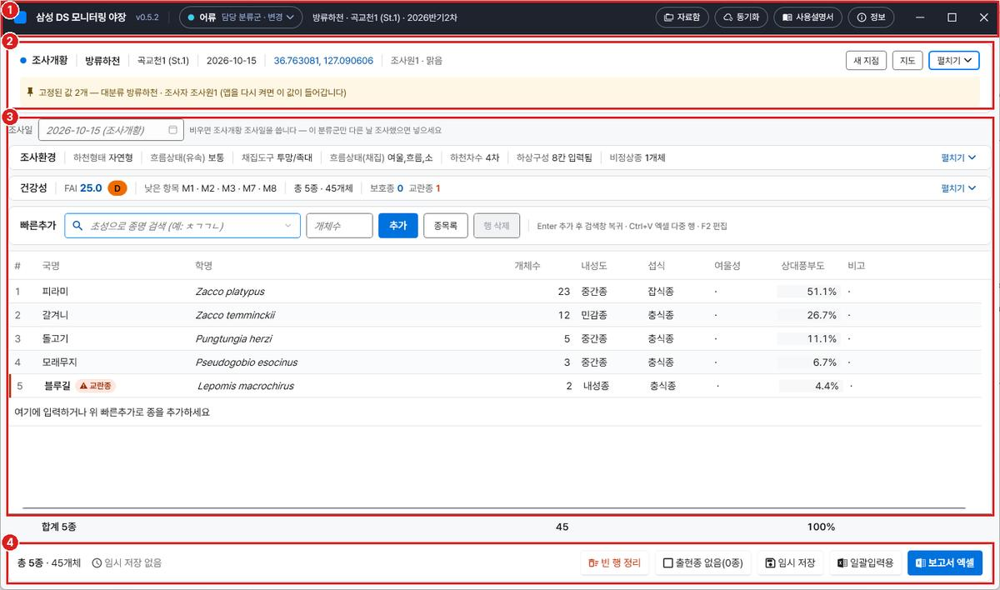

| 번호 | 설명 |
|---|---|
| ① | 캡션 바 — 앱 이름 · 판 · 분류군 칩 · 세션 요약 · [자료함] · [동기화] · [사용설명서] · [정보] |
| ② | 조사개황(접힘) — 대분류 · 지점 · 조사일 · 좌표 · 조사자 · 날씨 |
| ③ | 분류군 화면 — 지금 담당 분류군(어류) |
| ④ | 상태 바 — 총계 · 저장 상태 · 단추 |

메인 창은 위에서부터 캡션 바 · 조사개황(→ 3장) · 분류군 화면(→ 4 · 5장)입니다. 분류군 화면은 하나만 보이지만 7개 분류군 자료를 함께 들고 있습니다. 상태 바 바로 위에는 알릴 것이 있을 때만 알림 띠가 뜹니다(→ 2.3).

| 번호 | 설명 |
|---|---|
| ① | 앱 이름 · 판 |
| ② | 분류군 칩 |
| ③ | 세션 요약 |
| ④ | [자료함] · [동기화] |
| ⑤ | [사용설명서] |
| ⑥ | [정보] |

| 기능 | 설명 |
|---|---|
| 앱 이름 · 판 | 「삼성 DS 모니터링 야장」 · `v0.5.2` |
| 분류군 칩 | 지금 담당 분류군 + 「담당 분류군 · 변경」(→ 2.2) |
| 세션 요약 | 대분류 · 지점 · 연도차수 · 비면 「조사개황 미입력」 |
| [자료함] | 세션 목록 · 불러오기 · 내보내기(→ 7장) |
| [동기화] | 교환소 폴더에서 종목록 · 이상치 기준 받기(→ 9.4) |
| [사용설명서] | 이 설명서(PDF)를 엶 · 파일이 없으면 알림 띠로 알림 |
| [정보] | [프로그램 정보] 창(→ 10장) |
| 창 닫기 | 저장하지 않은 변경이 있으면 [저장 확인] 창(→ 7.4) |

- 캡션 바를 끌면 창이 옮겨지고, 두 번 누르면 최대화됩니다.
- 화면에 다 안 들어가면 본문 전체가 스크롤됩니다. 그리드 위 휠은 그리드가 먼저 움직입니다.
- 닫힌 선택 칸 위에서 휠을 돌려도 값은 바뀌지 않습니다.

## 2.2. 담당 분류군 바꾸기(분류군 칩)

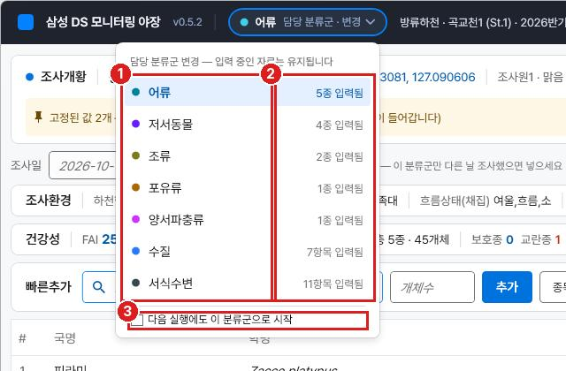

| 번호 | 설명 |
|---|---|
| ① | 분류군 7줄 — 지금 분류군은 굵은 글자 |
| ② | 분류군별 입력량 |
| ③ | 「다음 실행에도 이 분류군으로 시작」 |

1. 캡션 바 분류군 칩을 누릅니다.
2. 7줄에서 분류군을 누릅니다. 본문이 그 분류군 화면으로 바뀝니다.

- 입력한 자료는 그대로입니다(한 세션이 7개 분류군을 함께 담음).
- 줄 오른쪽 입력량은 종 수(수질 · 서식수변은 항목 수)이고, 없으면 `·` 입니다.
- 「다음 실행에도 이 분류군으로 시작」 을 끄면 다음 실행 때 분류군 고르기 창이 다시 뜹니다(→ 1.2).
- 함께 바뀌는 것: 조사개황 「하천유형」 선택지 · 생태현황 지점 목록(→ 3.1).

## 2.3. 분류군 화면 공통 틀(조사일 줄 · 접이식 칸 · 빠른추가 · 그리드 · 상태 바)

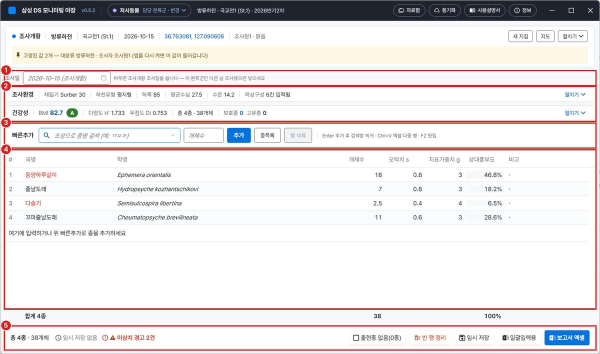

| 번호 | 설명 |
|---|---|
| ① | 조사일 줄 |
| ② | 접이식 칸 — 「조사환경」 · 「건강성」(접힘) |
| ③ | 「빠른추가」 |
| ④ | 종 그리드 · 합계 줄 |
| ⑤ | 상태 바 — 총계 · 저장 상태 · 단추 |

| 부분 | 설명 |
|---|---|
| 조사일 줄 | 이 분류군만 다른 날 조사했을 때 날짜를 넣음 · 비우면 조사개황 조사일 |
| 접이식 칸 | [펼치기] · [접기] · 접으면 한 줄 요약 · 어류 · 저서 · 수질 · 서식수변 |
| 「빠른추가」 | 종 검색 + 개체수 → **Enter** · [추가] · [종목록] · [행 삭제] (→ 4.0) |
| 그리드 | 맨 아래 새 행 줄 「여기에 입력하거나 위 빠른추가로 종을 추가하세요」 · 관찰형은 2단 행(→ 4.3) |
| 알림 띠 | 상태 바 바로 위 · 알릴 것이 있을 때만 한 줄 |
| 상태 바 | 왼쪽 총계 · 저장 상태 · 경고 / 오른쪽 단추 |

> 「비우면 조사개황 조사일을 씁니다 — 이 분류군만 다른 날 조사했으면 넣으세요」

### 상태 바

| 기능 | 설명 |
|---|---|
| 저장 상태 | 「임시 저장 없음」 → 저장 뒤 「자료함 저장됨 · {지점} {연도차수} · {시각}」 |
| 경고 | 빨간 글자 · 이상치 등 · 저장 · 내보내기를 막지 않음(→ 6장) |
| [출현종 없음(0종)] · [빈 행 정리] | 0종 선언 · 빈 행 지우기(→ 4.0) |
| [임시 저장] | 지금 분류군이 아니라 세션 전체를 자료함에 저장(→ 7.1) |
| [일괄입력용] · [보고서 엑셀] | 엑셀 내보내기(→ 8장) |

### 알림 띠

- 성공(체크)은 4초, 주의(느낌표)는 8초 뒤 사라집니다. [×] 로 바로 닫습니다.
- 여러 개면 차례로 보입니다. 길면 띠에 마우스를 올려 전체를 봅니다.
- 띠가 떠도 입력하던 칸의 커서는 그대로입니다.

| 언제 | 띠 |
|---|---|
| [임시 저장] | 「자료함에 저장되었습니다.」 · 빈 행 · 양식에 없는 값 · 합치기 결과가 있으면 덧붙임 |
| [일괄입력용] 막힘 | 「일괄입력용을 만들지 않았습니다.」 + 고칠 칸(→ 8.4) |
| 엑셀 저장 끝 | 확인할 것이 있을 때만 |
| 붙여넣기 · 관찰형 학명 | 넣지 않은 칸 · 「클립보드를 읽지 못했습니다 — 잠시 뒤 다시 붙여넣으세요」 · 학명 교정(→ 4.0 · 4.3) |
| 자료함 동작 | 불러오기 · 지점 복사 · 차수 복제 · 저장 · 삭제 · 내보내기 결과 |

- 같은 자료 확인 창에서 [취소] 하면 띠 없이 상태 바에만 「저장하지 않았습니다(같은 자료가 있어 취소)」 가 남습니다.

## 2.4. 확인 창 공통(Enter = 기본 · Esc = 취소)

- 단추 글자가 곧 동작입니다(예 [합치기] · [지점명만 고침(유지)]).
- 채운 파란 단추가 기본입니다. **Enter** = 기본 단추 · **Esc** 또는 × = 취소 몫 단추.

| 창 | 기본(**Enter**) | **Esc** · × | 자세히 |
|---|---|---|---|
| [저장 확인] | [예] | [취소] | 7.4 |
| [같은 자료가 이미 있습니다] | [합치기] | [취소] | 7.2 |
| [지점 변경] | [지점명만 고침(유지)] | [취소(바꾸지 않음)] | 3.4 |
| [목록 밖 지점] | [예] | [아니요] | 3.2 |
| [복구본이 있습니다] | [불러오기] | [나중에] | 7.7 |
| [저장 완료] | [파일 열기] | [닫기] | 8.1 |
| [행 삭제] | [취소] | [취소] | 4.0 |
| [세션 삭제] · [지도 삭제] | [취소] | [취소] | 7.3 · 3.6 |

> ⚠ 지우는 확인 창([행 삭제] · [세션 삭제] · [지도 삭제])은 습관적인 **Enter** 로 지워지지 않게 [취소] 가 기본입니다. 지우려면 [확인] 을 누릅니다. 되돌릴 수 없습니다.

# 3. 조사개황

조사개황은 7개 분류군이 함께 쓰는 공통 칸입니다. 세션 이름(대분류 · 연도차수 · 지점)도 여기서 정해집니다.

## 3.1. 칸과 자동 채움(대분류 · 지점 · 하천명 · 권역 · 하천유형)

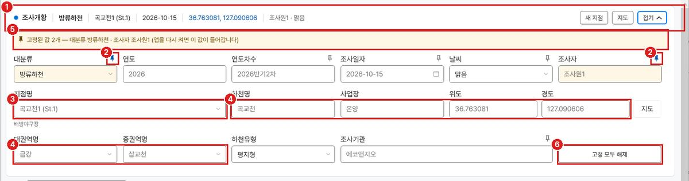

| 번호 | 설명 |
|---|---|
| ① | 머리줄 — 대분류 · 지점 · 조사일 · 좌표 · 조사자 · 날씨 · [새 지점] · [지도] · [접기] |
| ② | 압정(켜짐) — 「대분류」 · 「조사자」 |
| ③ | 「지점명」 |
| ④ | 지점을 고르면 채워지는 칸 — 「하천명」 · 「사업장」 · 「위도」 · 「경도」 · 「대권역명」 · 「중권역명」 |
| ⑤ | 압정 안내 띠 |
| ⑥ | [고정 모두 해제] |

- 접어도 머리줄은 늘 보입니다. 대분류를 안 골랐으면 빨간 「대분류 미선택」 이고, 이때는 접을 수 없습니다.

| 칸 | 설명 |
|---|---|
| 「대분류」 | 「방류하천」 · 「생태현황」 · 고르기 전에는 「지점명」 이 잠김 |
| 「연도」 · 「연도차수」 | 연도는 생태현황 지점 거르기용(비면 연도차수 앞 네 자리) · 연도차수 예 `2026반기2차` |
| 「조사일자」 · 「날씨」 · 「조사자」 · 「조사기관」 | 조사일자 처음 값은 오늘 · 날씨 「맑음」 · 「흐림」 · 「비(눈)」 |
| 「지점명」 | 목록에서 고르거나 이름 · ST번호를 침(→ 3.2) |
| 「하천명」 · 「사업장」 | 지점을 고르면 자동 · 고칠 수 있음 · 하천명을 고치면 칸 아래 「지점 목록: {하천}」 |
| 「위도」 · 「경도」 | 지점을 고르면 자동 · 옆 [지도] (→ 3.5) |
| 「대권역명」 · 「중권역명」 | 곡교천 → 「금강」 / 「삽교천」 · 오산천 · 원천리천 → 「한강」 / 「안성천」 자동 · 그 밖은 목록에서 고르거나 직접 적음 |
| 「하천유형」 | 분류군 양식대로 한 칸 — 어류 · 저서 「산간형」 · 「평지형」 · 「강」 / 수질 · 서식수변 「본류」 · 「지류」 · 「기타」 / 관찰형은 숨김(값은 남음) |

- 압정이 붙은 6칸은 → 3.3.
- 지점을 다시 고르면 하천명 · 사업장 · 좌표 · 권역을 지점 값으로 다시 채웁니다. 어류 「하천차수」 도 지점 값이 있으면 채웁니다(→ 4.1).

> ⚠ 「대분류」 를 바꾸면 지점명 · 하천명 · 사업장 · 좌표 · 권역이 묻지 않고 바로 비워집니다. 두 대분류에 이름이 같아도 다른 곳인 지점(예 `오산천1`)이 있기 때문입니다. 지점을 다시 고르고 하천명 · 권역을 확인합니다. 분류군 자료는 지워지지 않습니다.

### 생태현황 지점 목록

- 지금 분류군에 기록이 있는 지점만 보입니다. 다른 분류군 화면에서 고른 지점은 이름 뒤에 `(조류 지점)` 처럼 붙여 둡니다.
- 같은 이름이 해마다 다른 곳이면 「연도」 로 걸러 그 해 지점만 보입니다.
- 등록 지점이 없는 양서파충류는 지점명이나 하천명을 직접 적습니다.

## 3.2. 지점 칸 쓰는 법(ST번호 · Enter 규칙 · 목록 밖 지점)

친 글자와 비슷한 첫 후보를 저절로 고르지 않습니다. 엉뚱한 지점(예 `진위` → `진위천8`)이 들어가지 않게 하기 위해서입니다.

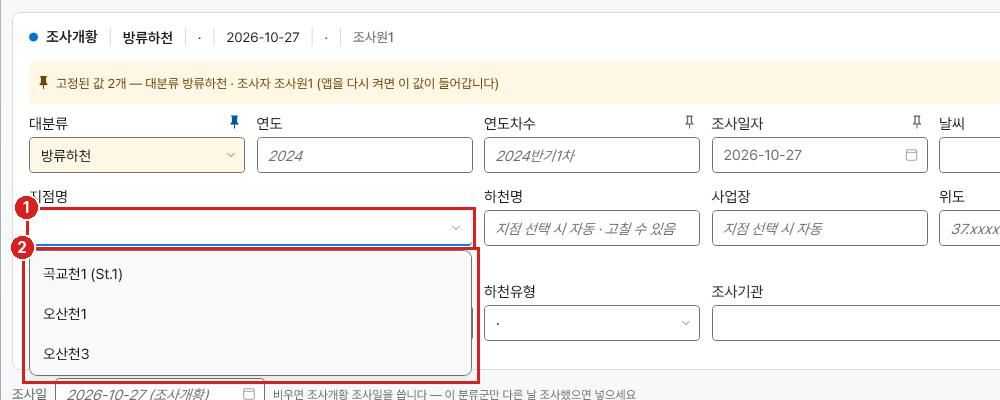

| 번호 | 설명 |
|---|---|
| ① | 「지점명」 칸 |
| ② | 후보 목록 |

| 방법 · 키 | 동작 |
|---|---|
| ▼ 로 목록을 열고 누름 | 바로 고름 |
| 이름을 그대로 치고 **Enter** · **Tab** | 똑같은 이름(옛 표기 포함)이면 고름 · 아니면 고르지 않음(아래 '목록에 없는 이름') |
| St.번호(`st1` · `St.1`)를 치고 **Enter** | 하나면 바로 고름 · 여럿이면 후보만 펼침 → 마우스로 고름 |
| 이름 일부를 치고 **↓** · **↑** | 친 글자로 거른 후보 안에서 옮김 · **Enter** 로 확정 |
| **Esc** | 후보 목록만 닫음(친 글자는 남음) |

> 「'{입력}' 에 맞는 지점이 {n}곳입니다 — 하나를 고르세요: {후보}」

- 예: `st1` + **Enter** → 곡교천1 (St.1) · 오산천1 · 오산천3 세 곳이 펼쳐집니다({{그림 site_list}}).
- St.번호는 번호가 빠짐 · 겹침 없이 다 있는 하천만 이름 옆에 보입니다(`곡교천1 (St.1)`).

### 목록에 없는 이름을 쳤을 때

| 대분류 | 동작 |
|---|---|
| 방류하천 | 고르지 않고 칸 아래 「'{입력}' 은(는) {대분류} 지점 목록에 없습니다 — 목록에서 고르세요.」 · 필요한 지점이 없으면 관리자에게 등록 요청 |
| 생태현황 | [목록 밖 지점] 창 → [예] 목록 밖 지점으로 입력 / [아니요] 칸으로 돌아감 |

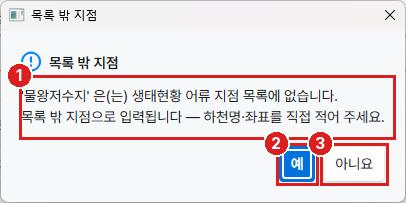

| 번호 | 설명 |
|---|---|
| ① | 문구 — 목록에 없는 이름 · 분류군 |
| ② | [예] — 기본 |
| ③ | [아니요] |

[예] 를 누르면 칸 아래에 「목록 밖 지점 — 하천명·좌표·대권역·중권역을 직접 적으세요」 가 보입니다. 그 칸들을 직접 적습니다.

- 지점명 없이 하천명만 적어도 저장됩니다. 세션 이름의 지점 자리는 `평택(지점명 없음)` 꼴이 됩니다.

## 3.3. 압정 6칸 · [고정 모두 해제]

앱을 켤 때마다 같은 값을 다시 치지 않도록 칸 값을 고정합니다({{그림 meta}} ②).

| 기능 | 설명 |
|---|---|
| 대상 6칸 | 「대분류」 · 「연도차수」 · 「조사일자」 · 「날씨」 · 「조사자」 · 「조사기관」 |
| 압정 켜기 · 끄기 | 칸 이름 옆 압정을 누름 · 켜면 칸 바탕이 연한 노랑이고 그 값을 기억 · 켠 채 고치면 새 값을 기억 |
| 앱을 다시 켤 때 | 기억 값이 빈 조사개황에 들어감 · 세션을 불러오면 세션 값이 우선 |
| [고정 모두 해제] | 켜 둔 압정을 모두 끔 · 다시 켜면 그때 칸 값을 기억 |
| 압정 안내 띠 | 켠 칸과 값 · 끝에 「(앱을 다시 켜면 이 값이 들어갑니다)」 · 불러온 세션 값과 다르면 「⚠ 지금 야장의 {칸} 은(는) 고정값과 다릅니다」 |

- 「조사일자」 를 고정하면 다음 날에도 그 날짜가 들어갑니다. 날짜가 바뀌면 고치거나 압정을 끕니다.
- [새 지점] 은 압정과 관계없이 6칸을 남깁니다(→ 3.4).

## 3.4. [새 지점] · 지점 변경 3가지

### [새 지점]

1. 조사개황 머리줄 [새 지점] 을 누릅니다.
2. 저장하지 않은 변경이 있으면 [저장 확인] 창에서 [예] · [아니요] · [취소] 를 고릅니다(→ 7.4).
3. 7개 분류군 입력 · 지점 · 하천명 · 사업장 · 좌표 · 권역 · 하천유형이 비워지고 「지점명」 칸에 커서가 갑니다.

> 「새 지점으로 시작하면 지금 화면의 입력과 지점이 비워집니다(대분류·연도차수·조사일자·날씨·조사자·조사기관은 압정과 관계없이 그대로).」

### 지점 변경 3가지

분류군 자료가 있는 채로 「지점명」 에서 다른 목록 지점을 고르면 [지점 변경] 창이 뜹니다. 처음 고를 때 · 자료가 없을 때는 묻지 않습니다.

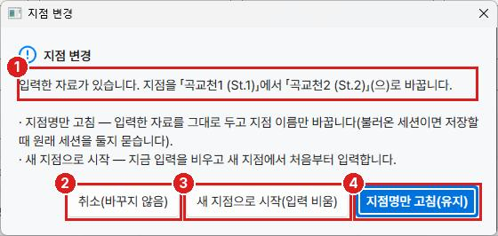

| 번호 | 설명 |
|---|---|
| ① | 문구 — 지금 지점 → 새 지점 |
| ② | [취소(바꾸지 않음)] |
| ③ | [새 지점으로 시작(입력 비움)] |
| ④ | [지점명만 고침(유지)] — 기본 |

| 단추 | 하는 일 |
|---|---|
| [취소(바꾸지 않음)] · **Esc** | 지점을 바꾸지 않음 |
| [새 지점으로 시작(입력 비움)] | 저장 확인 뒤 입력을 비우고 새 지점으로 시작([새 지점] 과 같음) |
| [지점명만 고침(유지)] · **Enter** | 입력 자료는 두고 지점 · 하천명 · 사업장 · 좌표 · 권역만 바꿈 |

> 불러온 세션에서 [지점명만 고침(유지)] 뒤 저장하면 「세션 이름이 바뀌었습니다」 창이 묻습니다. [새 세션으로 저장](기본)은 원래 세션을 그대로 두고, [원래 세션을 바꾸기] 는 원래 세션을 지우고 새 이름으로 옮깁니다(→ 7.1). 「연도차수」 · 「대분류」 를 고쳐 저장해도 같습니다.

## 3.5. 지도 보기

머리줄 또는 「경도」 옆 [지도] 를 누르면 [지도] 창이 열립니다. 좌표가 없어도 열립니다.

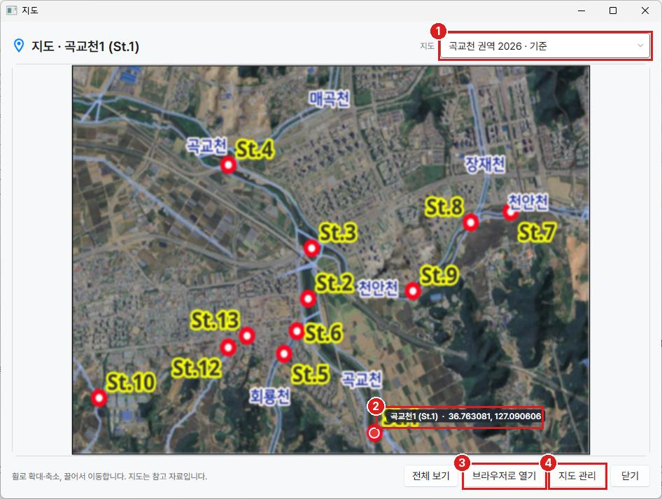

| 번호 | 설명 |
|---|---|
| ① | 「지도」 고르기 칸 |
| ② | 마커 — 지점 · 좌표 |
| ③ | [브라우저로 열기] |
| ④ | [지도 관리] |

| 기능 | 설명 |
|---|---|
| 「지도」 고르기 칸 | 이 지점 → 같은 대분류 → 모든 지도 순 · 처음엔 최신 지도 · 최신이 아니면 「참고용 · {지도}」 띠 |
| 마커 | 조사개황 좌표 · 보정한 지도에서 범위 안일 때만 |
| 휠 · 끌기 · [전체 보기] | 확대 · 축소 · 이동 · 창에 맞춤 |
| [브라우저로 열기] | 기본 브라우저 웹 지도에서 이 좌표를 엶(인터넷 필요) |
| [지도 관리] | → 3.6 |

마커가 안 나오면 지도 위 띠에 까닭이 나옵니다.

| 안내 | 고치는 법 |
|---|---|
| 「좌표가 아직 없습니다.」 · 「위도가 비어 있습니다.」 · 「경도가 비어 있습니다.」 | 지점을 고르거나 좌표를 넣음 |
| 「좌표 형식을 읽을 수 없습니다」 · 「좌표가 한국 범위를 벗어났습니다.」 | 십진(`36.763081`) 또는 도분초로 · 위도 · 경도가 바뀌지 않았는지 확인 |
| 「이 지도는 위치 표시를 지원하지 않습니다(보정 없음).」 | 보정(→ 3.6) 또는 다른 지도 |
| 「이 권역에 등록된 지도가 없습니다.」 · 범위 밖 | 다른 지도를 고르거나 [지도 관리] 에서 [추가] |

## 3.6. 지도 관리(추가 · 교체 · 보정 · 최신 · 적용 · 삭제)

> 「지도는 참고 자료입니다. 자유롭게 추가·교체·삭제할 수 있습니다. 매년 갱신본은 메일로 받아 [추가]하면 됩니다.」

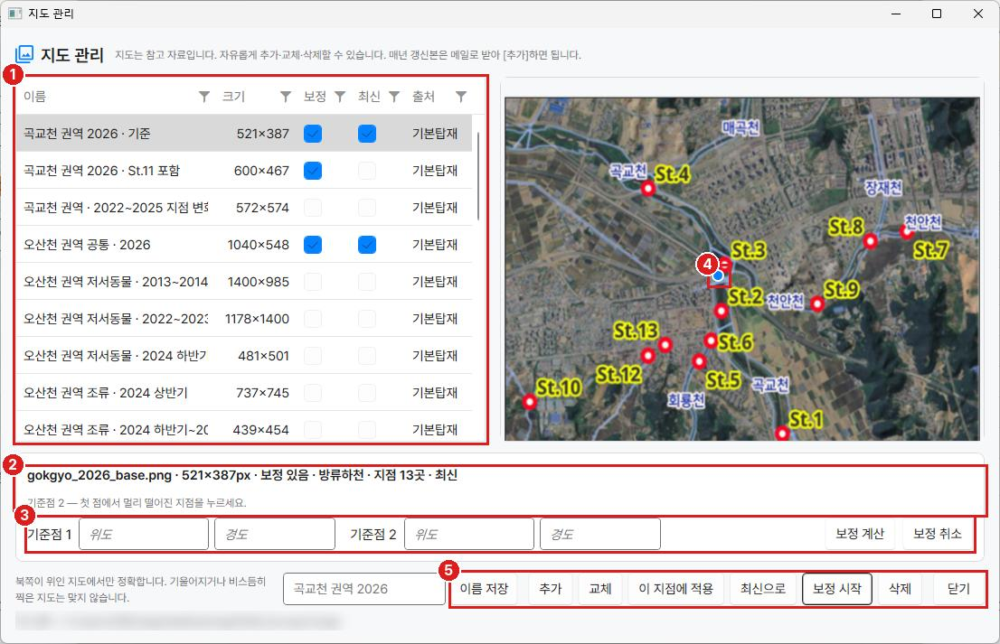

| 번호 | 설명 |
|---|---|
| ① | 지도 목록 |
| ② | 고른 지도 정보 · 보정 안내 |
| ③ | 기준점 칸 — 「기준점 1」 · 「기준점 2」 · [보정 계산] · [보정 취소] |
| ④ | 지도에 찍은 기준점 |
| ⑤ | 단추 줄 — [이름 저장] ~ [닫기] |

| 기능 | 설명 |
|---|---|
| [이름 저장] | 「지도 이름」 칸의 이름으로 |
| [추가] | png · jpg 그림을 자료 폴더 `maps\` 로 복사 · 목록에 「사용자추가」 |
| [교체] | 그림만 바꿈 · 픽셀 크기가 다르면 보정을 지움 |
| [이 지점에 적용] | 지금 대분류 · 지점을 이 지도의 적용 대상에 넣음 |
| [최신으로] | 처음 여는 기본 지도로 |
| [보정 시작] | 두 점 보정(아래) |
| [삭제] | 목록과 그림 파일을 지움 |

새 지도는 [추가] → [이 지점에 적용] → 보정 → [최신으로] 순으로 넣습니다.

### 보정(두 점으로 위치 맞추기)

1. 지도를 고르고 [보정 시작] 을 누릅니다.
2. 좌표를 아는 곳 두 군데를 차례로 누릅니다. 대각선으로 멀리 떨어진 두 점이 좋습니다.
3. 「기준점 1」 · 「기준점 2」 에 두 점의 위도 · 경도(십진 또는 도분초)를 넣습니다.
4. [보정 계산] 을 누르고 [지도] 창에서 마커 위치를 확인합니다. 그만두려면 [보정 취소].

> 「북쪽이 위인 지도에서만 정확합니다. 기울어지거나 비스듬히 찍은 지도는 맞지 않습니다.」

> ⚠ [삭제] 는 그림 파일까지 지웁니다. 「지도 삭제」 창은 지울 지도 이름을 보여 주고 [취소] 가 기본입니다 — 지우려면 [확인] 을 누릅니다.

> ⚠ 기본 지도(「기본탑재」)에 한 보정 · [교체] 는 새 판이 기본 지도를 바꿀 때 덮일 수 있습니다(→ 1.5). 오래 쓸 지도는 [추가] 해서 씁니다.

# 4. 종 입력

어류 · 저서동물 · 조류 · 포유류 · 양서파충류 화면은 종을 한 행씩 넣습니다. 4.0 은 다섯 화면 공통, 4.3~4.6 은 관찰형입니다.

## 4.0. 공통

| 기능 | 설명 |
|---|---|
| 빠른추가 | 초성 검색 → 개체수 → **Enter** · 종목록에 있는 종만 |
| [종목록] 창 | 등록 종 전체에서 두 번 눌러 넣기 · 개체수는 빈칸 |
| 그리드 맨 아래 새 행 | 한 행씩 직접 입력 · 목록 밖 국명도 됨 |
| **Ctrl+V** | 엑셀 야장 여러 줄 · 목록 밖 국명도 됨 |

### 빠른추가

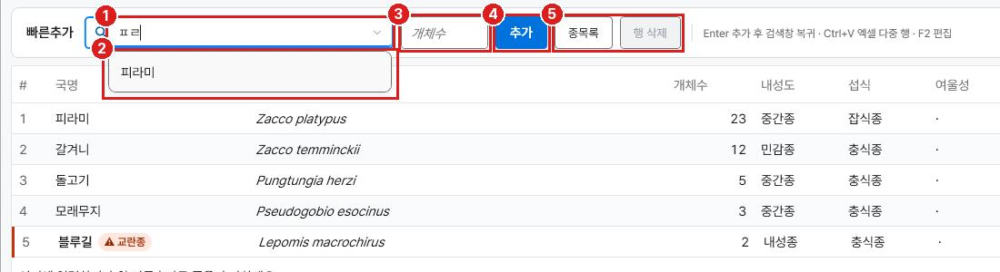

| 번호 | 설명 |
|---|---|
| ① | 종명 검색 칸 — 초성 `ㅍㄹ` |
| ② | 후보 목록 — 같은 이름 → 앞부분 → 포함 순 |
| ③ | 개체수 칸 |
| ④ | [추가] |
| ⑤ | [종목록] · [행 삭제] |

1. 검색 칸에 초성이나 이름 일부를 칩니다(예 `ㅍㄹ` → 피라미).
2. 후보를 마우스로 누릅니다(맨 위 후보는 **↓**). 커서가 개체수 칸으로 넘어갑니다.
3. 개체수를 치고 **Enter**([추가] 와 같음). 커서가 검색 칸으로 돌아옵니다.

- 검색 칸 **Enter** 는 이름을 똑같이 친 종만 고릅니다. 종을 고르지 않으면 [추가] 도 아무것도 넣지 않습니다.
- 개체수: 어류 · 관찰형 = 정수 · 저서동물 = 소수 가능(→ 6.1). 빈칸은 미입력(→ 6.2).
- 같은 종(어류 · 저서)은 있던 행에 더하고 칩 「{종명} {전}+{값} → {합} (합산)」 을 띄웁니다.

> ⚠ 관찰형(조류 · 포유류 · 양서파충류)은 같은 종을 합치지 않고 새 행으로 넣은 뒤 알리기만 합니다(4.3).

### [종목록] 창

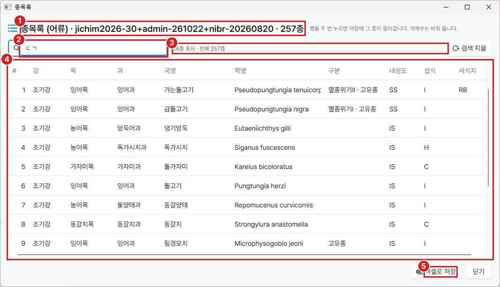

| 번호 | 설명 |
|---|---|
| ① | 제목 줄 — 분류군 · 종목록 판 · 전체 종 수 |
| ② | 검색 칸 — 국명 · 학명 · 초성(`ㄷㄱ`) |
| ③ | 거른 종 수 |
| ④ | 종 목록 — 행을 두 번 누르면 야장에 넣음 |
| ⑤ | [엑셀로 저장] |

1. 빠른추가 바의 [종목록] 을 누릅니다. 담당 분류군 종만 보입니다.
2. 국명 · 학명 · 초성으로 찾습니다.
3. 행을 두 번 누릅니다. 개체수 빈칸으로 그리드에 들어가고 창이 닫힙니다.
4. 그리드에서 개체수를 넣습니다.

- 이미 있는 종이면 칩 「{종명} · 이미 있음」 만 뜹니다. 목록 엑셀은 [엑셀로 저장] (→ 8.5).

### 종 그리드

| 기능 | 설명 |
|---|---|
| 맨 아래 새 행 | 「여기에 입력하거나 위 빠른추가로 종을 추가하세요」 줄에 국명 · 개체수 → **Enter** |
| 고치기 | 칸을 두 번 누르거나 **F2** · 국명 칸은 초성 후보 |
| 국명 칸 **Enter** | 똑같은 이름 · 고른 후보 → 그 종 · 그 밖 → 친 글자 그대로(목록 밖 국명) |
| 개체수 칸 | 빠른추가와 같은 검사(→ 6.1) |
| 학명 · 자동 열 | 읽기 전용 · 종목록 값 |
| 비고 열(어류 · 저서) | 세션에만 저장 · 엑셀에 나가지 않음 |

- 행은 넣은 순서 그대로입니다(정렬 없음).

> ⚠ 국명 칸에 초성(`ㅍㄹ`)만 치고 **Enter** 를 누르면 `ㅍㄹ` 이라는 목록 밖 국명이 들어갑니다. 후보를 **↓** 나 마우스로 고른 뒤 **Enter** 를 누릅니다.

### 경고가 붙은 행

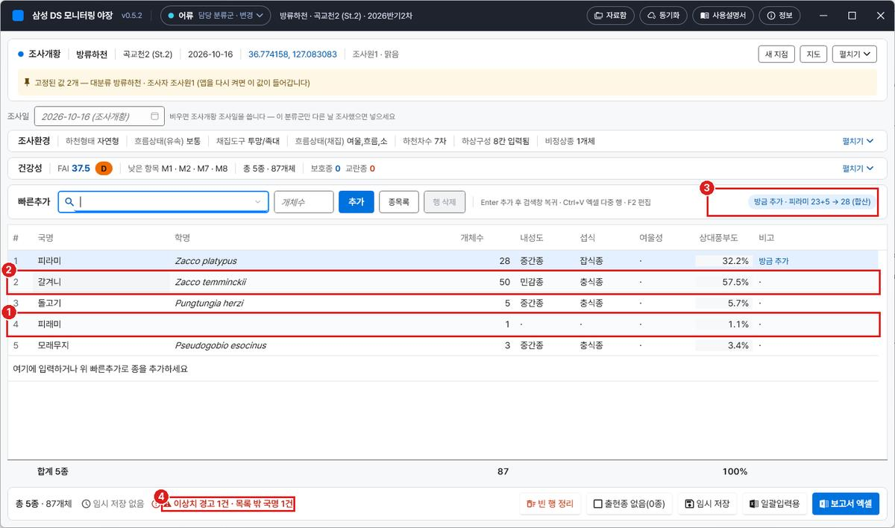

| 번호 | 설명 |
|---|---|
| ① | 목록 밖 국명 행 — 학명 `·` |
| ② | 이상치 행 — 마우스를 올리면 까닭 |
| ③ | 합산 칩 |
| ④ | 상태 바 경고 |

| 행 경고 | 뜻 |
|---|---|
| 「종목록에 없는 국명 — 오타인지 확인하세요」 | 목록 밖 국명(아래) |
| 「과거 기록 없음 (신규 종 확인)」 · 「과거 최대 {n}개체 초과」 | 이상치(→ 6.4) |
| 「같은 종이 {n}행 — 합쳐야 계산이 맞습니다」 | 예전 세션의 중복(아래) |

- 행에 마우스를 올리면 까닭이 보이고, 상태 바에 건수가 모입니다. 저장 · 내보내기는 막지 않습니다.

### 엑셀에서 붙여넣기(**Ctrl+V**)

1. 엑셀에서 국명 · 개체수 두 열을 머리글 줄 없이 복사합니다.
2. 그리드 칸을 한 번 누르고 **Ctrl+V** 를 누릅니다.

- 어류 · 저서는 1열 국명 · 2열 개체수입니다(3열부터 무시). 관찰형 → 4.3.
- 같은 종은 합산합니다. 종목록에 없는 국명은 목록 밖 국명으로 들어갑니다.
- 정수(저서는 숫자)가 아닌 개체수 칸은 비우고 알림 띠로 알립니다.
- 「클립보드를 읽지 못했습니다 — 잠시 뒤 다시 붙여넣으세요」 가 뜨면 다시 **Ctrl+V** 를 누릅니다.

> ⚠ 머리글 줄까지 붙이면 「국명」 이라는 목록 밖 종 행이 생깁니다. [행 삭제] 로 지웁니다.

### 목록 밖 종

- 그리드 새 행 국명 칸에 치고 후보를 고르지 않은 채 확정하거나, 붙여넣을 때만 들어갑니다.
- 지우지 않고 저장합니다. 학명 · 자동 열은 `·` 입니다.
- 어류 FAI 의 종수 · 개체수에는 들어가고 길드 항목에서는 빠집니다. 저서는 BMI 에서 빠집니다.
- 오타(예 `피래미`)면 국명 칸에서 후보를 다시 고릅니다.

### 같은 종

- 빠른추가 · 붙여넣기 · 국명 고치기로 같은 종이 되면 먼저 있던 행에 개체수를 더합니다(빈칸 + 3 = 3).
- 예전 세션의 중복은 저절로 합치지 않습니다. 한 행에 더하고 나머지는 [행 삭제] 로 지웁니다.
- 저서는 국명이 같아도 학명이 다르면 다른 종입니다(예 물벌레류 2종). [종목록] 창에서 학명을 보고 고릅니다.

### 행 삭제 · 빈 행 정리

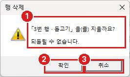

| 번호 | 설명 |
|---|---|
| ① | 지울 행 — 행 번호 · 종명 |
| ② | [확인] — 지움 |
| ③ | [취소] — 기본 단추 |

1. 지울 행을 마우스로 누릅니다.
2. [행 삭제] 를 누르거나, 행 위 오른쪽 단추 → [이 행 삭제].
3. 확인 창에서 [확인] 을 누릅니다.

> 「{n}번 행 · {종명}」 을(를) 지울까요?

- 기본 단추는 [취소] 라 **Enter** 로는 지워지지 않습니다.
- 방향키 · **Tab** · **Enter** 로 칸을 옮기면 [행 삭제] 가 꺼집니다. 행을 다시 누릅니다.
- [빈 행 정리] 는 국명 · 개체수가 모두 빈 행을 확인 없이 지웁니다.

> ⚠ 지운 행은 되돌릴 수 없습니다.

### 분류군 조사일

- 일곱 화면 맨 위 「조사일」 칸입니다. 비우면 조사개황 조사일을 씁니다(칸에 흐리게 보임).
- 이 분류군만 다른 날 조사했으면 날짜를 넣습니다. 이 분류군 엑셀의 조사일이 됩니다.

### [출현종 없음(0종)]

- 어류 · 저서에서 조사했으나 0종일 때 켭니다. 점수 0 · 등급 E 가 되고 엑셀 단추가 켜집니다.
- 조사불가 사유가 있으면 그쪽이 앞섭니다.
- 종 행이 하나라도 있으면 켜져 있어도 0종 선언을 쓰지 않습니다 — 하천차수 확인 · FAI · BMI · [일괄입력용] 이 종이 있을 때와 같습니다. 상태 바에 「종이 있어 0종 선언을 쓰지 않습니다 — [출현종 없음] 을 끄세요」 가 뜨면 끕니다.

### 조사불가 사유

- 어류 「조사불가 사유」 · 저서 「채집불가시(사유)」 는 접근불가 · 건천화 · 준설 · 공사중 중 하나를 고릅니다. 지우기는 [비우기].
- 고르면 등급 '-'(미평가)입니다. 0종(E)과 다릅니다. 덧붙일 말은 비고에 적습니다.
- 예전 세션 글(예 `접근불가(홍수)`)은 「{값} (양식 외)」 로 남고 등급이 나옵니다. 네 낱말 중 하나를 다시 고릅니다(→ 6.5).
- 서식수변은 규칙이 다릅니다(→ 5.1).

## 4.1. 어류

- 「조사환경」 · 「건강성」 은 처음에 접혀 있습니다. [펼치기] 로 엽니다. 접힌 줄에도 주요 값과 경고가 보입니다.

### 조사환경

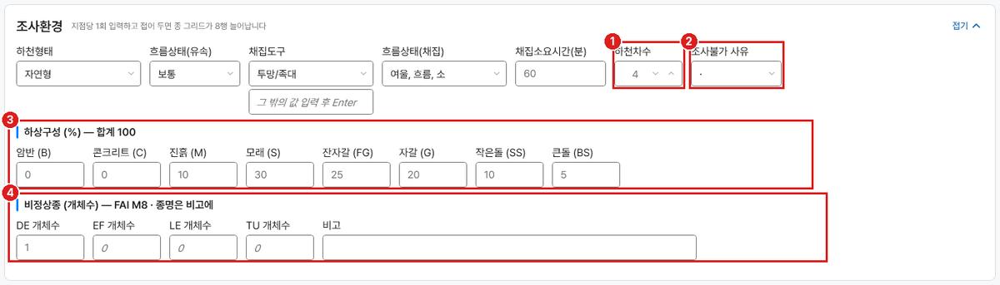

| 번호 | 설명 |
|---|---|
| ① | 「하천차수」 — 지점 값이 미리 들어감 |
| ② | 「조사불가 사유」 |
| ③ | 하상구성 8칸 — 합계 100 |
| ④ | 비정상종 4칸 · 「비고」 |

| 칸 | 입력 |
|---|---|
| 「하천형태」 · 「흐름상태(유속)」 · 「채집도구」 · 「흐름상태(채집)」 | 양식 선택지(채집도구는 직접 입력도) |
| 「채집소요시간(분)」 | 정수 |
| 하상구성 8칸 | 「암반 (B)」 ~ 「큰돌 (BS)」 · % 정수 |
| 「DE 개체수」 · 「EF 개체수」 · 「LE 개체수」 · 「TU 개체수」 | 비정상종 · 정수 |

### 하천차수

- 지점을 고르면 지점 값이 들어갑니다(예 곡교천1 = 4). 고친 값은 지점을 바꿔도 남습니다.
- FAI M1 · M2 · M3 · M7 의 구간표를 고르는 값입니다(0~7).
- 비거나 0 이면 FAI 가 '-' 이고 「하천차수 필요」 가 뜹니다. [일괄입력용] 도 만들지 않습니다(→ 8.4).

> ⚠ 지점 목록에 하천차수가 없는 지점도 있습니다. 「하천차수 필요」 가 뜨면 조사환경 「하천차수」 를 직접 넣습니다.

### 하상구성 · 비정상종

- 하상 8칸(암반 · 콘크리트 포함) 합이 100 이 아니면 「하상구성 합계 {합}% — 100 이 되어야 합니다」 가 뜹니다(막지 않음).
- 비정상종(DE 기형 · EF 지느러미 손상 · LE 피부 손상 · TU 종양)은 지점 전체 개체수입니다. 합이 FAI M8 에 쓰입니다.
- 종명은 「비고」 에 적습니다(예 `붕어 DE 1`).

### 건강성(FAI)

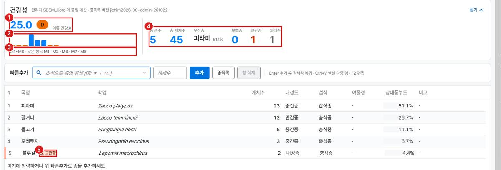

| 번호 | 설명 |
|---|---|
| ① | FAI 점수 · 등급 |
| ② | M1~M8 막대 |
| ③ | 낮은 항목 |
| ④ | 총 종수 · 총 개체수 · 우점종 · 보호종 · 교란종 · 외래종 |
| ⑤ | 「⚠ 교란종」 뱃지 |

| 기능 | 설명 |
|---|---|
| 「FAI」 · 등급 | 소수 1자리 · A ≥80 · B ≥60 · C ≥40 · D ≥20 · E · 못 내면 '-' |
| M1~M8 막대 | 0 · 6.25 · 12.5점 · 마우스를 올리면 항목 이름 · 「낮은 항목」 은 색이 다름 |
| 「총 종수」 ~ 「외래종」 | 개체수 1 이상인 종만 셈 · 외래종은 M1 · M7 · M6 에서 빠짐 |

- 등급 '-': 조사불가 · 하천차수 없음 · 종도 0종 선언도 없음.
- 국명 뱃지: 「멸종위기Ⅰ」 · 「멸종위기Ⅱ」 · 「천연기념물」(보호종) · 「⚠ 교란종」(보호종과 뜻이 반대) · 「외래종」.

## 4.2. 저서동물

- 화면 짜임은 어류와 같습니다. 개체수에 소수를 넣을 수 있습니다(예 다슬기 `2.5`).

### 조사환경

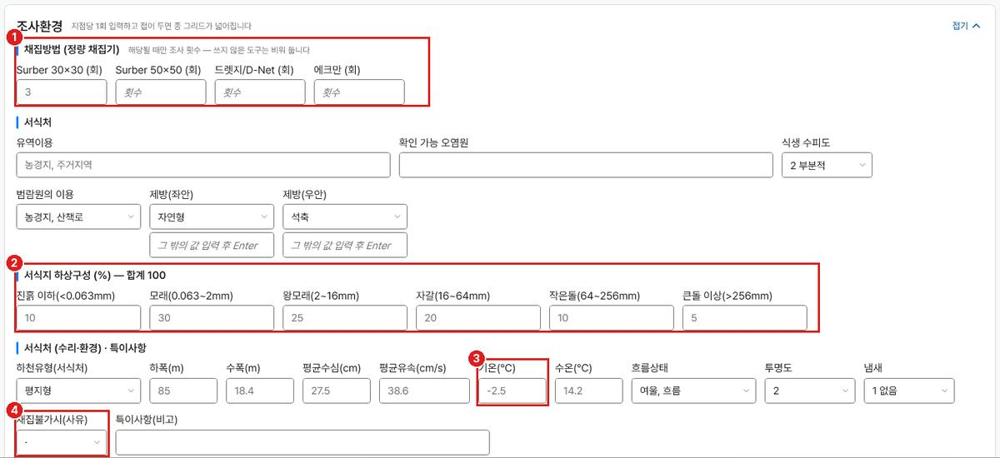

| 번호 | 설명 |
|---|---|
| ① | 채집방법 (정량 채집기) 4칸 |
| ② | 서식지 하상구성 6칸 |
| ③ | 「기온(℃)」 — 영하 가능 |
| ④ | 「채집불가시(사유)」 |

| 칸 | 입력 |
|---|---|
| 채집기 4칸 | 「Surber 30×30 (회)」 · 「Surber 50×50 (회)」 · 「드렛지/D-Net (회)」 · 「에크만 (회)」 — 쓴 도구 횟수만 |
| 서식처 칸 | 「유역이용」 · 「확인 가능 오염원」 = 글 · 「식생 수피도」 · 「범람원의 이용」 · 「제방(좌안)」 · 「제방(우안)」 = 선택지 |
| 수리 · 환경 칸 | 「하천유형(서식처)」 · 「흐름상태」 · 「투명도」 · 「냄새」 = 선택지 · 하폭 ~ 수온 6칸 = 소수 |
| 「기온(℃)」 | 맨 앞 `-` 가능(예 `-2.5`) |

- 「하천유형(서식처)」 는 조사개황 「하천유형」 과 다른 칸입니다.

### 하상구성 · 소수 칸

- 하상은 지침 서식 2 <표 1> 6칸입니다. 암반 · 콘크리트는 「특이사항(비고)」 에 적습니다.
- 예전 세션의 암반 · 콘크리트 값은 열 때 특이사항으로 옮겨집니다. 알림 띠가 뜨면 [임시 저장] 을 누릅니다.
- 하폭 ~ 수온 6칸은 숫자 · 소수점 하나만 받습니다(→ 6.1). 예전 세션 글자(예 `18.3Z`)는 [일괄입력용] 을 막습니다(→ 8.4).

### 건강성(BMI · 다양도)

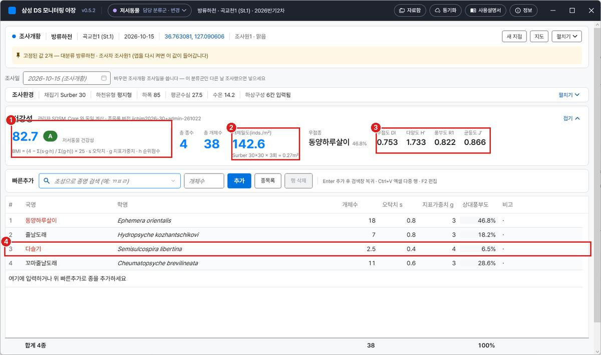

| 번호 | 설명 |
|---|---|
| ① | BMI 점수 · 등급 · 계산식 |
| ② | 개체밀도 · 근거 줄 |
| ③ | 우점도 DI · 다양도 H' · 풍부도 R1 · 균등도 J' |
| ④ | 소수 개체수 행 |

| 기능 | 설명 |
|---|---|
| 「BMI」 · 등급 | 소수 1자리 · A ≥80 · B ≥65 · C ≥50 · D ≥35 · E · '-' 규칙은 어류와 같음 |
| 계산식 줄 | s 오탁치 · g 지표가중치는 종목록 값 · h 는 개체수 순위점수 |
| 「우점도 DI」 · 「다양도 H'」 · 「풍부도 R1」 · 「균등도 J'」 | 소수 3자리 · 종이 없으면 `·` |
| 「보호종」 · 「고유종」 | 멸종위기Ⅰ · Ⅱ · 종목록 고유종 |

### 개체밀도

- 「개체밀도(inds./㎡)」 = 총 개체수 ÷ 채집 면적(Surber 30×30 0.09㎡ · 50×50 0.25㎡ · 에크만 0.0225㎡ × 횟수).
- 근거 줄에 계산이 보입니다(예 Surber 30×30 3회 → 0.27㎡).
- 드렛지/D-Net 을 썼으면 「환산 불가(드렛지/D-Net: 면적 기준 없음)」 가 뜹니다.

> ⚠ 개체밀도는 화면과 보고서용 엑셀에만 보입니다. 지수(BMI · DI · H' · R1 · J') · 일괄입력용 · 세션은 실측 개체수 그대로입니다.

## 4.3. 관찰형 공통

조류 · 포유류 · 양서파충류는 같은 틀입니다. 관찰 한 건이 한 행이고, 지수 대신 종수 · 개체수 · 보호종 · 교란종만 요약합니다.

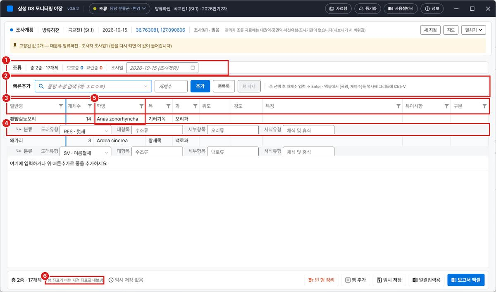

| 번호 | 설명 |
|---|---|
| ① | 요약 줄 — 종수 · 개체수 · 「보호종」 · 「교란종」 · 분류군 「조사일」 |
| ② | 빠른추가 — 종을 고르고 수량을 넣은 뒤 **Enter** |
| ③ | 1행 — 「일반명」부터 「구분」까지 관찰 기본 칸 |
| ④ | 2행 「분류」 줄 — 분류군마다 다른 칸(늘 펼쳐 있음) |
| ⑤ | 「학명」 — 종목록에 있는 종은 잠김 |
| ⑥ | 상태 바 — 「행 좌표가 비면 지점 좌표로 내보냄」 |

| 기능 | 설명 |
|---|---|
| 같은 종 | 합치지 않고 새 행 · 「같은 종 {n}행」 표시 |
| 「목록 밖」 | 종목록에 없는 국명 · 학명 · 목 · 과는 직접 입력 |
| 「구분」 | 멸종위기 · 천연기념물 · 생태계교란생물 표기(자동) |
| [행 추가] · [빈 행 정리] | 빈 행 추가 · 국명과 수량이 모두 빈 행 제거 |
| [일괄입력용] · [보고서 엑셀] | 국명이 있는 행이 있으면 켜짐 · 막힘 없음 |

- 어류 · 저서와 달리 **같은 종을 합치지 않습니다**(자리 · 흔적이 다른 관찰). 두 번 넣은 것이면 [행 삭제]로 지웁니다.
- 「보호종」과 「교란종」은 뜻이 반대라 숫자 · 색을 따로 둡니다.

### 1행과 2행

| 분류군 | 2행 | 빠른추가 수량 → 들어가는 칸 |
|---|---|---|
| 조류 | 「분류」 줄 4칸(4.4) | 「개체수」 → 1행 「개체수」 |
| 포유류 | 「흔적」 줄 12칸(4.5) | 「관찰 개체수」 → 2행 「관찰」 |
| 양서파충류 | 「관찰」 줄 6칸(4.6) | 「성체 개체수」 → 2행 「성체」 |

- 종을 고르면 「학명」 · 「목」 · 「과」 · 「구분」이 종목록대로 채워집니다.
- `·` 는 미입력, `0` 은 실측 0 입니다. 수량 칸은 0 이상 정수만 받습니다(→ 6.1).

### 행 좌표

- 「위도」 · 「경도」(십진 도)는 지점과 다른 곳에서 봤을 때만 적습니다.
- 둘 다 비운 행은 내보낼 때 조사개황 지점 좌표로 채웁니다. 한쪽만 적은 행은 그대로입니다.

> ⚠ 붙여넣은 좌표가 도분초(`37_12_44` 등)면 말없이 빈칸이 되고 지점 좌표로 나갑니다. 십진 도로 바꿔 붙여넣습니다.

### 붙여넣기 열 순서

**Ctrl+V** 열 순서는 그리드와 다릅니다 — 2행 칸이 위도 · 경도보다 앞입니다.

| 분류군 | 복사할 열 순서(첫째 열부터) |
|---|---|
| 조류(13열) | 국명 · 개체수 · 학명 · 목 · 과 · 도래유형 · 대항목 · 세부항목 · 서식유형 · 위도 · 경도 · 특징 · 특이사항 |
| 포유류(21열) | 국명 · 학명 · 목 · 과 · 관찰지유형 · 흔적 12칸(포획~기타 · 화면 순서) · 위도 · 경도 · 특징 · 특이사항 |
| 양서파충류(16열) | 국명 · 학명 · 목 · 과 · 대분류 · 중분류 · 관찰 6칸(성체~기타) · 위도 · 경도 · 특징 · 특이사항 |

- 뒤쪽 열은 없어도 됩니다(조류는 국명 · 개체수 2열도 됨). 머리글 줄은 빼고 복사합니다(→ 4.0).
- 도래유형은 이름(`텃새`)도 코드로, 서식유형 `1`~`6` 은 이름으로 바꿉니다.

### 학명 규칙

- 종목록 국명이면 「학명」이 잠깁니다. 목록 밖 국명만 직접 적습니다. 「목」 · 「과」는 고칠 수 있습니다.
- 붙여넣기 · 예전 세션에서 다른 학명이 오면 종목록 학명으로 바꾸고 알립니다.

> 「학명 {n}건을 종목록대로 바꿨습니다」

### 요약

- 수량 합: 조류 = 「개체수」 · 포유류 = 흔적 12칸(단위 「흔적」) · 양서파충류 = 관찰 6칸. 포유류 · 양서는 상태 바에 행 수(기록 · 관찰 건수)도 보입니다.
- 국명이 있는데 수량이 빈 행은 막지 않고 저장 · 내보내기 뒤 알림 띠로 알립니다. 빈칸은 빈칸으로 나갑니다.

## 4.4. 조류

화면은 {{그림 bird}} 입니다. 2행 「분류」 줄에 4칸이 있습니다.

| 기능 | 설명 |
|---|---|
| 「도래유형」 | `RES · 텃새` · `SV · 여름철새` · `WV · 겨울철새` · `PM · 통과철새` 중 고르기 · [비우기] |
| 「대항목」 · 「세부항목」 | 자유 글 |
| 「서식유형」 | 번호를 치면 이름 — `1` 번식확실 · `2` 번식추측 · `3` 월동확실 · `4` 채식 및 휴식 · `5` 소리 · `6` 이동 |

- 선택지 밖 예전 값은 지우지 않고 「{값} (양식 외)」로 남깁니다.

### 조류 입력 순서(예: 흰뺨검둥오리 14)

1. 빠른추가에 `ㅎㅃㄱㄷㅇㄹ` 을 치고 흰뺨검둥오리를 고릅니다.
2. 「개체수」에 `14` 를 치고 **Enter** 를 누릅니다.
3. 2행 「도래유형」 · 「서식유형」을 넣고 [임시 저장] 을 누릅니다.

## 4.5. 포유류

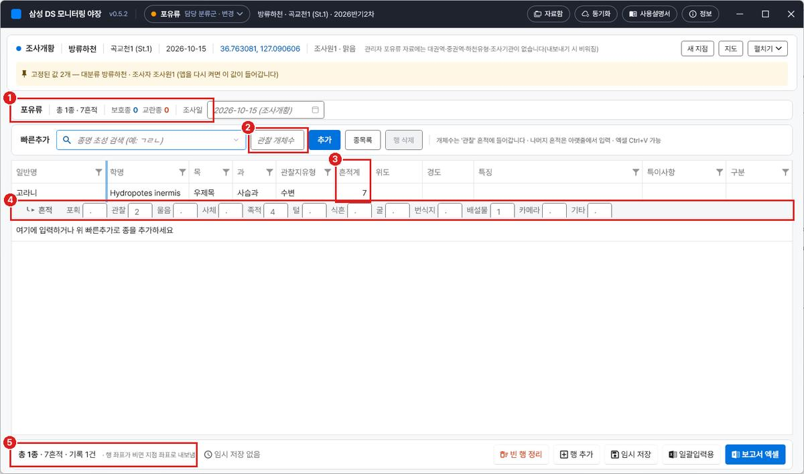

| 번호 | 설명 |
|---|---|
| ① | 요약 줄 — 수량 단위가 「흔적」 |
| ② | 빠른추가 수량 「관찰 개체수」 — 2행 「관찰」로 들어감 |
| ③ | 「흔적계」 — 흔적 12칸 합(자동) |
| ④ | 2행 「흔적」 줄 12칸 |
| ⑤ | 상태 바 — 종수 · 흔적 수 · 기록 건수 |

| 기능 | 설명 |
|---|---|
| 「관찰지유형」 | 자유 글 |
| 「흔적계」 | 흔적 12칸 합(자동) |
| 2행 「흔적」 줄 | 「포획」 · 「관찰」 · 「울음」 · 「사체」 · 「족적」 · 「털」 · 「식흔」 · 「굴」 · 「번식지」 · 「배설물」 · 「카메라」 · 「기타」 — 개체 수 또는 횟수(정수) |

- 수량은 흔적 12칸 합이라 실제 개체 수와 다를 수 있습니다.

### 포유류 입력 순서(예: 고라니)

1. 빠른추가에 `ㄱㄹㄴ` 을 치고 고라니를 고릅니다.
2. 「관찰 개체수」에 `1` 을 치고 **Enter** — 2행 「관찰」에 들어갑니다.
3. 본 흔적 칸(예 「족적」 · 「배설물」)에 수를 치고 [임시 저장] 을 누릅니다. 「흔적계」에 합이 보입니다.

## 4.6. 양서파충류

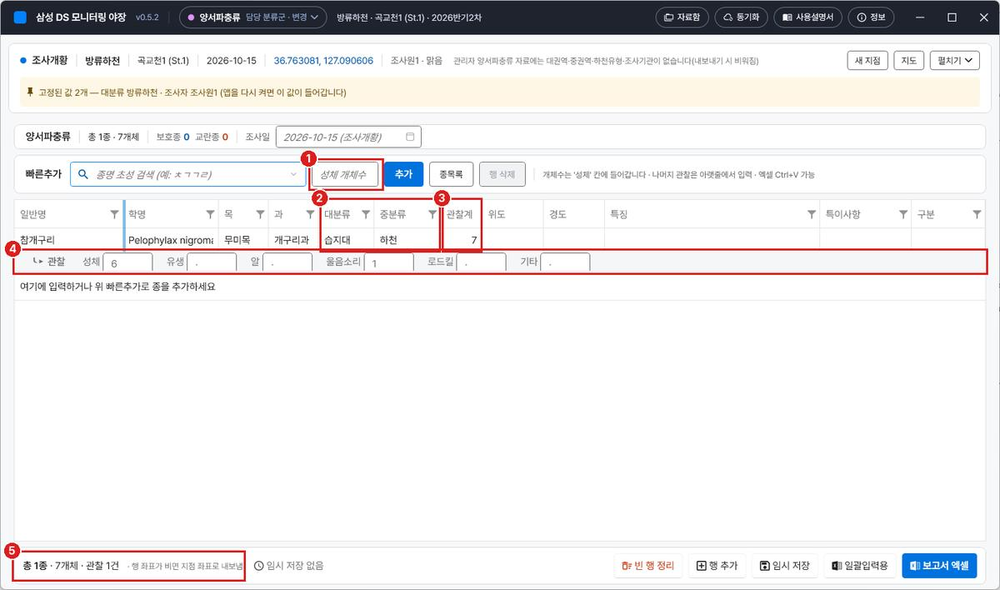

| 번호 | 설명 |
|---|---|
| ① | 빠른추가 수량 「성체 개체수」 — 2행 「성체」로 들어감 |
| ② | 「대분류」 · 「중분류」 — 서식지 유형 |
| ③ | 「관찰계」 — 관찰 6칸 합(자동) |
| ④ | 2행 「관찰」 줄 6칸 |
| ⑤ | 상태 바 — 종수 · 개체수 · 관찰 건수 |

| 기능 | 설명 |
|---|---|
| 「대분류」 | 서식지 유형 · `농림지역` · `산림지역` · `습지대` · `기타 지역` |
| 「중분류」 | 대분류별 항목 여러 개 · `, ` 로 이음 |
| 「관찰계」 | 관찰 6칸 합(자동) |
| 2행 「관찰」 줄 | 「성체」 · 「유생」 · 「알」 · 「울음소리」 · 「로드킬」 · 「기타」(정수) |

- 「대분류」는 조사개황 「대분류」(방류하천 · 생태현황)와 다른 칸입니다.
- 대분류부터 고릅니다. 대분류를 바꾸면 맞지 않는 중분류는 지웁니다. 두 칸은 칸을 눌러 편집 상태에서 고릅니다.
- 선택지 밖 예전 값은 지우지 않고 「양식 외」로 표시합니다.

### 양서파충류 입력 순서(예: 참개구리)

1. 빠른추가에 `ㅊㄱㄱㄹ` 을 치고 참개구리를 고릅니다.
2. 「성체 개체수」에 `6` 을 치고 **Enter** 를 누릅니다.
3. 「대분류」 `습지대` · 「중분류」 `하천` 을 고르고 [임시 저장] 을 누릅니다.

# 5. 환경자료

서식수변 · 수질은 항목 입력 화면입니다. 넣는 즉시 등급이 계산되고, 등급은 조사자가 넣지 않습니다.

## 5.1. 서식수변

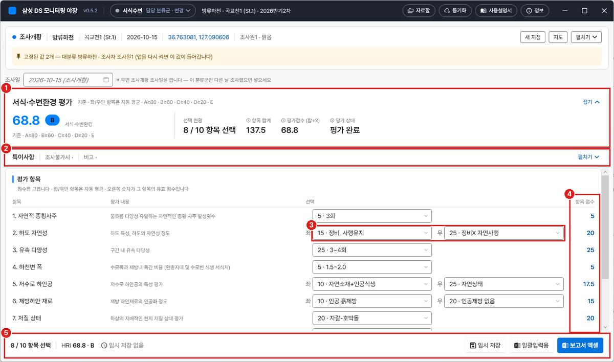

| 번호 | 설명 |
|---|---|
| ① | 「서식·수변환경 평가」 펼침 — 평가점수 · 등급 · 계산 과정 |
| ② | 「특이사항」 접힌 줄 — 「조사불가시」 · 「비고」 값 |
| ③ | 좌 · 우 점수 칸 — 두 값의 평균이 항목 점수 |
| ④ | 「항목 점수」 열 — `·` 는 미선택 |
| ⑤ | 상태 바 — 선택 수 · HRI · 등급 |

| 기능 | 설명 |
|---|---|
| 「서식·수변환경 평가」 | HRI 점수 · 등급 · 「선택」 수 · 「항목 합계」 · 평가 상태 |
| 「특이사항」 | 「조사불가시」 · 「비고」 |
| 「평가 항목」 | 10항목 점수 고르기(칸 15개) |
| 「항목 점수」 | 계산에 쓰는 점수(좌 · 우는 평균 · 한쪽만이면 그 값) |

### 10항목과 점수

| 항목 | 칸 | 점수 |
|---|---|---|
| 「1. 자연적 종횡사주」 | 하나 | 10 · 5 · 3 · 1 · 0 |
| 「2. 하도 자연성」 | 좌 · 우 | 25 · 15 · 10 · 5 · 0 |
| 「3. 유속 다양성」 | 하나 | 30 · 25 · 15 · 5 · 0 |
| 「4. 하천변 폭」 | 하나 | 10 · 5 · 3 · 1 · 0 |
| 「5. 저수로 하안공」 | 좌 · 우 | 25 · 10 · 5 · 3 · 0 |
| 「6. 제방하안 재료」 | 좌 · 우 | 20 · 10 · 5 · 3 · 0 |
| 「7. 저질 상태」 | 하나 | 30 · 20 · 10 · 3 · 0 |
| 「8. 횡구조물」 | 하나 | 30 · 20 · 10 · 3 · 0 |
| 「9. 제외지 토지 이용」 | 좌 · 우 | 10 · 5 · 3 · 1 · 0 |
| 「10. 제내지 토지 이용」 | 좌 · 우 | 10 · 5 · 3 · 1 · 0 |

- 항목 이름 · 점수 칸에 마우스를 올리면 평가 내용 · 판정 기준이 나옵니다.

### 점수 고르기

1. **Tab** 으로 점수 칸에 갑니다.
2. 점수 숫자를 칩니다(예 `2` `5` → 25점 · 1초 안에 이어 침). 없는 점수는 무시합니다.
3. **Tab** 으로 다음 칸에 갑니다.

- 비우려면 목록 맨 아래 [비우기] 를 누르거나 **Delete** · **Backspace** 를 누릅니다.

### HRI · 등급

- 항목 합계 ÷ 2 = 평가점수 → 등급 A≥80 · B≥60 · C≥40 · D≥20 · E.
- 하나도 고르지 않으면 `-`(미평가), 모두 0점이면 0 · E 입니다.

> ⚠ 고르지 않은 항목은 합계에 들어가지 않습니다. 「{n} / 10 항목 선택」의 n 이 10 인지 확인하고 내보냅니다.

### 조사불가시

- 글에 `접근불가` 가 들어 있으면 등급이 `-`(「등급 산정 제외」)이고 점수는 그대로 보입니다.
- 건천화 · 준설 · 공사중 같은 다른 사유는 등급에 영향이 없습니다. 어류 · 저서의 조사불가 사유(네 낱말 고르기)와 규칙이 다릅니다.

### 서식수변 내보내기

- 15칸 중 하나라도 골랐거나 「조사불가시」가 있으면 켜집니다(「비고」만으로는 꺼짐). 막히는 조건은 없습니다.
- 일괄입력용에는 항목 점수(좌 · 우는 평균)만 나가고 평가점수 · 등급은 관리자가 다시 계산합니다(→ 부록 B.6).

## 5.2. 수질

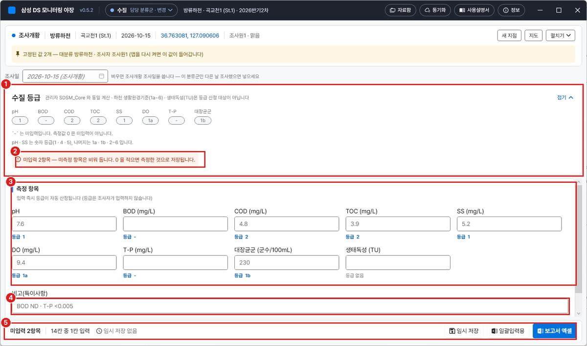

| 번호 | 설명 |
|---|---|
| ① | 「수질 등급」 펼침 — 등급 8종 · `-` 는 미입력 |
| ② | 미입력 경고 — 「미입력 {n}항목」 |
| ③ | 「측정 항목」 9칸 — 칸 아래 그 항목 등급 |
| ④ | 「비고(특이사항)」 — 검출한계 미만 · 기타 |
| ⑤ | 「추가 항목」 접힌 줄 — 「14칸 중 {n}칸 입력」 · 「현장 측정」 |

| 기능 | 설명 |
|---|---|
| 「수질 등급」 | 등급 8종 자동 · 접어도 요약 줄에 보임 |
| 「측정 항목」 | 9칸 · 칸 아래 등급 · 생태독성은 「등급 없음」 |
| 「비고(특이사항)」 | 검출한계 미만 · 기타 글 |
| 「추가 항목」 | 「수질 확장」 9칸 · 「현장 측정」 5칸 · 등급 없음 |

### 등급 기준

| 항목 | 1a | 1b | 2 | 3 | 4 | 5 | 6 |
|---|---|---|---|---|---|---|---|
| BOD | ≤1 | ≤2 | ≤3 | ≤5 | ≤8 | ≤10 | >10 |
| COD | ≤2 | ≤4 | ≤5 | ≤7 | ≤9 | ≤11 | >11 |
| TOC | ≤2 | ≤3 | ≤4 | ≤5 | ≤6 | ≤8 | >8 |
| T-P | ≤0.02 | ≤0.04 | ≤0.1 | ≤0.2 | ≤0.3 | ≤0.5 | >0.5 |
| DO | ≥7.5 | ≥5 | — | — | ≥2 | — | <2 |
| 대장균군 | ≤50 | ≤500 | ≤1000 | ≤5000 | >5000 | — | — |

- pH 는 6.5~8.5 면 1, 그 밖은 4 · SS 는 ≤25 면 1, ≤100 이면 4, 그 밖은 5 입니다.

### 측정 칸 · 검출한계 미만

- 23칸(측정 9 · 추가 14)은 숫자와 소수점 하나만 받습니다(→ 6.1).
- 빈칸은 미측정(등급 `-`), `0` 은 측정값 0 입니다.
- 검출한계 미만(ND · <값)은 측정 칸을 비우고 「비고(특이사항)」에 `BOD ND · T-P <0.005` 처럼 적습니다.

> 「숫자만 넣습니다 — 검출한계 미만은 칸을 비우고 비고(특이사항)에 ND 또는 <값을 적으세요」

- 비고는 세션 · 보고서에만 남고 일괄입력용에는 나가지 않습니다. 비고만으로는 내보내기가 켜지지 않습니다.

### [일괄입력용] 이 막힐 때

예전 판 세션의 측정 칸에 `<0.5` · `ND` · `1,000` 같은 글자가 남아 있으면 「숫자가 아닌 칸」 경고가 뜨고 파일을 만들지 않습니다.

> 「일괄입력용을 만들지 않았습니다」

1. 경고에 나온 칸 값을 지웁니다.
2. 숫자만 다시 치거나, 검출한계 미만이면 비고로 옮깁니다.
3. [임시 저장] 뒤 [일괄입력용] 을 다시 누릅니다.

- [보고서 엑셀] 은 막지 않습니다. 내보내기는 23칸 중 하나라도 값이 있으면 켜집니다(→ 부록 B.7).

# 6. 입력 칸 규칙

새로 치는 틀린 값은 칸이 받지 않습니다. 예전 세션에 남은 값은 지우지 않고 경고합니다.

| 기능 | 설명 |
|---|---|
| 정수 · 소수 칸 | 맞지 않는 글자는 받지 않고 되돌림 |
| 빈칸과 0 | 빈칸 = 미입력 · 0 = 실측 0 |
| 경고 | 저장 · 내보내기를 막지 않음 |
| 막힘 | [일괄입력용] 만 만들지 않음 |
| 이상치 경고 | `reference.json` 의 과거 기록과 비교 |
| 선택 칸 | 양식 선택지만 · 예전 값은 「{값} (양식 외)」 |

## 6.1. 정수 칸 · 소수 칸(되돌림 · 안내 문구 · 영하)

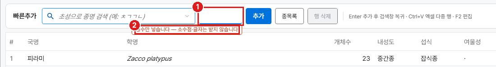

| 번호 | 설명 |
|---|---|
| ① | 정수 칸(어류 빠른추가 「개체수」) — `1.5` 를 친 순간 |
| ② | 칸 아래 안내 「정수만 넣습니다 — 소수점·글자는 받지 않습니다」 |

1. 맞지 않는 글자를 치면 받지 않고, 칸을 들어왔을 때 값으로 되돌립니다(`1.5` 를 치면 `1` 도 남지 않음).
2. 칸 아래 안내가 2.5초쯤 뜹니다. 그동안 이어 치는 숫자도 받지 않습니다.
3. **Backspace** · 방향키 · **Tab** 을 누르거나 칸을 다시 누르면 바로 칠 수 있습니다.

- 붙여넣기(**Ctrl+V**)도 같습니다. 쉼표도 받지 않으니 `1,200` 은 `1200` 으로 칩니다.

| 칸 | 받는 값 · 안내 |
|---|---|
| 개체수(어류 · 조류) · 포유류 흔적 · 양서 관찰 · 「채집소요시간(분)」 · 「DE 개체수」~「TU 개체수」 · 저서 채집기 | 0 이상 정수 · 「정수만 넣습니다 — 소수점·글자는 받지 않습니다」 |
| 하상구성 % | 「0~{n} 사이 정수만 넣습니다」 |
| 저서 개체수 · 「하폭(m)」~「수온(℃)」 | 「숫자만 넣습니다 — 글자 · 쉼표는 받지 않습니다(소수점은 하나)」 · 「기온(℃)」 만 맨 앞 `-` 가능 |
| 수질 측정 23칸 | 「숫자만 넣습니다 — 검출한계 미만은 칸을 비우고 비고(특이사항)에 ND 또는 <값을 적으세요」 |

> ⚠ 검출한계 미만(`ND` · `<0.5`)은 측정 칸을 비우고 「비고(특이사항)」 에 적습니다(→ 5.2).

## 6.2. 빈칸과 0

| 곳 | 빈칸 | 0 |
|---|---|---|
| 어류 · 저서 개체수 | 미입력 `·` · 「{n}행 개체수 미입력」 | 실측 0 · 종수에 세지 않음 |
| 관찰형 개체수 · 흔적 · 관찰 | 빈칸 그대로 내보냄 | 0 그대로 내보냄 |
| 수질 측정 칸 | 미측정 · 등급 `-` | 측정값 0 · 등급 산정 |
| 서식수변 점수 | 모두 미선택이면 미평가 `-` | 모두 0점이면 0 · E |
| 어류 「하천차수」 | FAI `-` | 빈칸과 같음 |

- 한 종도 없으면 0 행 대신 [출현종 없음(0종)] 을 켭니다(→ 4.0).

> ⚠ 재지 않은 항목에 0 을 적지 않습니다. 「미측정 항목은 비워 둡니다. 0 을 적으면 측정한 것으로 저장됩니다.」

## 6.3. 경고와 막힘(분류군별 표)

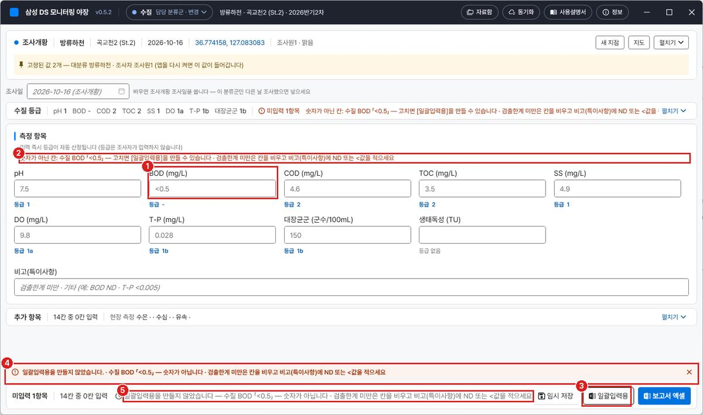

| 번호 | 설명 |
|---|---|
| ① | 수질 「BOD (mg/L)」 칸 — 예전 세션 값 `<0.5` |
| ② | 칸 경고 — 「숫자가 아닌 칸:」 |
| ③ | [일괄입력용] |
| ④ | 알림 띠 — 「일괄입력용을 만들지 않았습니다.」 |
| ⑤ | 상태 바 — 「일괄입력용을 만들지 않았습니다 — {까닭}」 |

| 기능 | 설명 |
|---|---|
| 경고 | 칸 아래 · 행 글자색 · 상태 바 · 저장과 내보내기는 됨 |
| 막힘 | [일괄입력용] 저장 창이 뜨지 않음 · 알림 띠와 상태 바에 까닭 · [보고서 엑셀] 은 됨 |

| 분류군 | 경고(막지 않음) | 막힘([일괄입력용]만) |
|---|---|---|
| 어류 | 하상 합계 ≠ 100 · 양식 외 값 · 이상치 · 목록 밖 국명 · 같은 종 중복 · 개체수 미입력 | 「하천차수」 빈칸 · 비정상종 칸이 정수 아님 |
| 저서동물 | 하상 합계 ≠ 100 · 채집기 횟수 정수 아님 · 양식 외 값 · 이상치 · 목록 밖 국명 · 같은 종 중복 | 「하폭(m)」~「수온(℃)」 6칸이 숫자 아님 |
| 조류 · 포유류 · 양서파충류 · 서식수변 | 목록 밖 국명 · 같은 종 여러 행 · 빈 행 · 양식 외 값 | 없음 |
| 수질 | 숫자가 아닌 칸 · 미입력 항목 | 측정 칸이 숫자 아님 |

- 막혔을 때 고치는 법은 8.4.

## 6.4. 이상치 경고

어류 · 저서 개체수를 `reference.json`(어류 55종 · 저서 118종)의 과거 최대와 견줍니다({{그림 grid_warn}}).

| 문구 | 뜻 |
|---|---|
| 「과거 최대 {n}개체 초과」 | 과거 최대보다 많음 |
| 「과거 기록 없음 (신규 종 확인)」 | 기준자료에 없는 종 · 흔한 종에도 자주 붙음 |

- 행 글자색 · 툴팁 · 상태 바 「이상치 경고 {n}건」 으로 알립니다. **막지 않습니다.**
- 국명 · 개체수가 맞으면 그대로 둡니다. 기준자료 바꾸기는 9.3.

## 6.5. 선택 칸 · 양식 외 값

| 기능 | 설명 |
|---|---|
| 고르기 칸 | 양식 선택지만 · 하나 또는 여럿 · [비우기] 로 빈칸 |
| 직접 입력 | 어류 「채집도구」 · 저서 「제방(좌안)」 · 「제방(우안)」 만 「그 밖의 값 입력 후 Enter」 |
| 양식 외 값 | 예전 값 → 「{값} (양식 외)」 + 칸 아래 「양식 외 값 {값} · 지우지 않음 — 확인하세요」 |

1. 목록에서 양식 값을 다시 고르면 경고가 사라집니다.
2. 그대로 두어도 저장 · 내보내기는 됩니다(글자 그대로).

- 어류 「조사불가 사유」 · 저서 「채집불가시(사유)」 는 네 낱말 중 하나를 골라야 등급이 `-` 입니다. 예전 글(`접근불가(홍수)`)은 다시 고릅니다(→ 4.1 · 4.2).

# 7. 자료함

자료함은 이 PC 에 저장한 세션 목록입니다(`%AppData%\SDSM_Surveyor\sessions\`). 세션 한 건 = 대분류 · 연도차수 · 지점 하나의 조사개황과 7개 분류군 자료입니다. 자동 저장은 없습니다.

| 기능 | 설명 |
|---|---|
| [임시 저장] | 세션 전체 저장 |
| [자료함] | 불러오기 · 삭제 · 복사 · 일괄 출력 · 주고받기 |
| [지점 복사] · [차수 복제] | 다음 지점 · 다음 차수로 이어 쓰기 |
| [내보내기] · [가져오기] | zip 파일로 다른 PC 에 옮기기 |
| 복구본 | 오류 때 화면을 따로 남김 |

## 7.1. [임시 저장] (세션 전체 · 세션 이름)

1. 조사개황 「대분류」 · 「연도차수」 · 「지점명」 을 채웁니다.
2. 아무 분류군 화면에서 [임시 저장] 을 누릅니다. 조사개황과 자료가 있는 분류군이 모두 저장됩니다.
3. 상태 바에 「자료함 저장됨 · {지점} {연도차수} · {시각}」, 알림 띠에 「자료함에 저장되었습니다.」 가 뜹니다.

- 세션 이름은 `{대분류}_{연도차수}_{지점}.json` 입니다(→ 8.6).
- 불러온 세션을 다시 저장하면 그 세션에 덮어씁니다. 다른 세션과 겹치면 7.2.

> ⚠ 세 칸이 비어 있어도 `무제_…` 이름으로 저장됩니다. 먼저 채웁니다.

불러온 세션의 「대분류」 · 「연도차수」 · 「지점명」 을 바꿔 저장하면 세션 이름이 달라집니다. 이때 「세션 이름이 바뀌었습니다」 창이 묻습니다.

| 단추 | 하는 일 |
|---|---|
| [새 세션으로 저장] (기본 · **Enter**) | 지금 화면을 새 이름으로 저장 · 원래 세션은 그대로 |
| [원래 세션을 바꾸기] | 원래 세션을 지우고 새 이름으로 옮김 |
| [취소] (**Esc**) | 저장하지 않음 |

- 새 이름에 다른 세션이 이미 있으면 이어서 「같은 자료가 이미 있습니다」 창이 뜹니다(→ 7.2).
- 지난 차수를 남기며 새 차수를 만들 때는 [차수 복제] 가 편합니다(→ 7.5).

> ⚠ [원래 세션을 바꾸기] 는 원래 세션을 지웁니다. 되돌릴 수 없습니다.

## 7.2. 같은 자료가 있을 때(합치기 · 바꾸기)

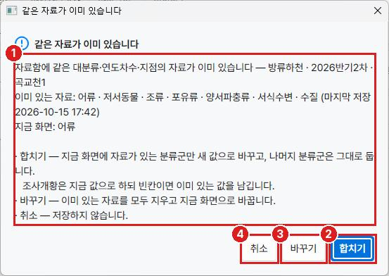

| 번호 | 설명 |
|---|---|
| ① | 문구 — 이미 있는 자료 · 지금 화면의 분류군 · 마지막 저장 시각 |
| ② | [합치기] — 기본(**Enter**) |
| ③ | [바꾸기] |
| ④ | [취소] — **Esc** |

저장하려는 세션이 자료함에 이미 있고, 지금 화면이 그 세션을 불러온 것이 아닐 때 뜹니다(예 [새 지점] 뒤 같은 지점 · [지점 복사] · [차수 복제] · 복구본).

| 단추 | 하는 일 |
|---|---|
| [합치기] | 지금 자료가 있는 분류군만 새 값 · 나머지 분류군은 그대로 · 조사개황 빈칸은 기존 값 |
| [바꾸기] | 기존 세션을 지우고 지금 화면으로 저장 |
| [취소] | 저장하지 않음 · 상태 바에만 「저장하지 않았습니다(같은 자료가 있어 취소)」 |

- 분류군을 나눠 입력했다면 [합치기] 를 고릅니다. 합친 세션이 화면에 다시 올라옵니다.

> ⚠ [바꾸기] 는 기존 세션의 다른 분류군 자료까지 지웁니다. 되돌릴 수 없습니다.

## 7.3. 불러오기 · 검색 · 삭제

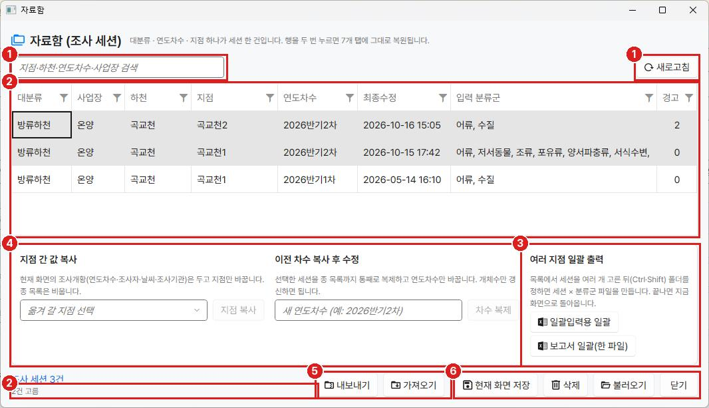

| 번호 | 설명 |
|---|---|
| ① | 검색 칸 · [새로고침] |
| ② | 세션 목록 · 「경고」 열 · 2건 고름 |
| ③ | 여러 지점 일괄 출력 — [일괄입력용 일괄] · [보고서 일괄(한 파일)] · 8.3 |
| ④ | 지점 간 값 복사 · 이전 차수 복사 후 수정(7.5) |
| ⑤ | [내보내기] · [가져오기] · 7.6 |
| ⑥ | [현재 화면 저장] · [삭제] · [불러오기] · [닫기] |

캡션 바 [자료함] 으로 엽니다.

| 기능 | 설명 |
|---|---|
| 검색 칸 | 지점 · 하천 · 연도차수 · 대분류 · 사업장 일부로 거름 |
| 「경고」 열 | 비어 있는 키 칸 · 목록에 없는 지점 · 조사일자 없음 · 조사자 없음 수 |
| 여러 개 고르기 | **Ctrl** · **Shift** + 누르기 → 「{n}건 고름」 |

1. 세션을 고르고 [불러오기] 를 누릅니다. 행을 두 번 눌러도 됩니다.
2. 저장 안 한 입력이 있으면 저장 확인 창이 뜹니다(→ 7.4).
3. 지울 때는 세션을 고르고 [삭제] → 「세션 삭제」 창에서 [확인] 을 누릅니다.

> ⚠ 자료함 [삭제] 는 되돌릴 수 없습니다. 「세션 삭제」 창은 지울 세션 이름 · 건수를 보여 주고 [취소] 가 기본이라 **Enter** 로는 지워지지 않습니다.

## 7.4. 닫을 때 저장 확인

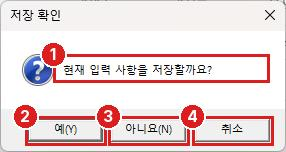

| 번호 | 설명 |
|---|---|
| ① | 「현재 입력 사항을 저장할까요?」 |
| ② | [예] — 기본 |
| ③ | [아니요] |
| ④ | [취소] |

마지막 저장 · 불러오기 뒤 바뀐 것이 있으면 창 닫기 · [새 지점] · 자료함 [불러오기] · [지점 복사] · [차수 복제] · 일괄 출력 전에 묻습니다.

| 단추 | 하는 일 |
|---|---|
| [예] | 저장하고 계속 · 같은 자료가 있으면 7.2 |
| [아니요] | 저장하지 않고 계속 |
| [취소] | 멈춤 |

- [예] 인데 키 칸이 비어 있으면 「저장할 수 없음」 창이 뜨고 멈춥니다.

> ⚠ [아니요] 는 마지막 저장 뒤의 입력을 버립니다.

## 7.5. 지점 간 값 복사 · 이전 차수 복제

### 지점 간 값 복사

조사개황은 두고 지점만 바꾸며, 분류군 자료는 비웁니다.

1. 「옮겨 갈 지점 선택」 에서 지점을 고르고 [지점 복사] 를 누릅니다.
2. 새 지점 화면에서 입력하고 [임시 저장] 을 누릅니다.

- 「하천유형」 은 그대로 남으니 확인합니다.

### 이전 차수 복제

종 목록까지 복제하고 연도차수만 바꿉니다.

1. 지난 차수 세션을 고르고 「새 연도차수 (예: 2026반기2차)」 에 새 값을 칩니다.
2. [차수 복제] 를 누릅니다. 「조사일자」 는 오늘, 분류군 「조사일」 은 빈칸이 됩니다.
3. 바뀐 개체수만 고치고 [임시 저장] 을 누릅니다.

- 「연도」 는 그대로입니다. 해가 바뀌었으면 고칩니다.

## 7.6. 다른 PC 로 옮기기(zip 내보내기 · 가져오기)

1. 내보내기 — 세션을 고르고(**Ctrl** · **Shift**) [내보내기] → `자료함_yyyyMMdd_HHmm_n건.zip` 으로 저장합니다.
2. 가져오기 — [가져오기] → zip 을 고릅니다. 「가져오기 결과」 창에 건수가 나옵니다.

| 같은 세션이 있을 때 | 하는 일 |
|---|---|
| [덮어쓰기] · [나머지도 모두 덮어쓰기] | 가져온 것으로 바꿈 |
| [건너뜀] (기본) · [나머지도 모두 건너뜀] | 가져오지 않음 |

- 지금 화면은 바뀌지 않습니다. 분류군별로 합치지 않습니다.

> ⚠ [덮어쓰기] 하면 그 세션(7개 분류군 전부)이 바뀝니다. 되돌릴 수 없습니다.

> ⚠ 「지금 화면에 열려 있는 세션을 덮어썼습니다.」 가 나오면 먼저 그 세션을 [불러오기] 합니다. 그대로 [임시 저장] 하면 가져온 내용을 다시 덮어씁니다.

## 7.7. 복구본

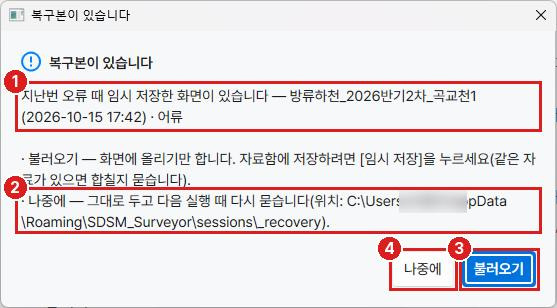

| 번호 | 설명 |
|---|---|
| ① | 복구본 — 세션 · 저장 시각 · 분류군 |
| ② | 위치 — 자료함 `_recovery` 폴더 |
| ③ | [불러오기] — 기본 |
| ④ | [나중에] |

예기치 않은 오류 때 화면에 분류군 자료가 있으면 `sessions\_recovery\` 에 복구본을 남깁니다(정식 세션은 덮지 않음). 다음 실행 때 「복구본이 있습니다」 창이 뜹니다.

1. [불러오기] 를 누릅니다. 화면에만 올라옵니다(아직 저장 안 됨).
2. 확인하고 [임시 저장] 을 누릅니다. 같은 세션이 있으면 [합치기] 를 고릅니다(→ 7.2).

- [나중에] 는 그대로 두고 다음 실행 때 다시 묻습니다. 오류 창은 11.2.

# 8. 엑셀 내보내기

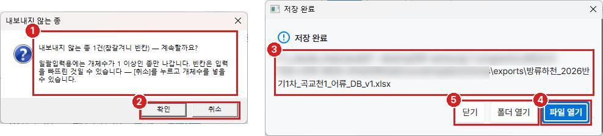

| 번호 | 설명 |
|---|---|
| ① | 「내보내지 않는 종」 창 — 빠지는 종과 개체수 |
| ② | [확인] · [취소] |
| ③ | 「저장 완료」 창 — 저장한 파일 경로 |
| ④ | [파일 열기] — 기본 |
| ⑤ | [폴더 열기] · [닫기] |

| 기능 | 설명 |
|---|---|
| [일괄입력용] | 관리자 일괄등록에 넣는 제출용 파일 |
| [보고서 엑셀] | 조사개황 · 출현종 · 지수 · 등급 시트의 기록용 파일 |
| [일괄입력용 일괄] · [보고서 일괄(한 파일)] | 자료함에서 여러 세션을 한 번에 |
| [엑셀로 저장] | 종목록 전체를 엑셀로 |

## 8.1. 보고서용 · 일괄입력용(저장 완료 창)

1. 분류군 화면 아래 [일괄입력용] 또는 [보고서 엑셀] 을 누릅니다.
2. 저장 창에서 위치를 정합니다. 창은 지난번에 내보낸 로컬 폴더나 '문서' 에서 열립니다. 파일 이름은 자동입니다(→ 8.6).
3. 「저장 완료」 창에서 [파일 열기] (기본) · [폴더 열기] · [닫기] 중 하나를 누릅니다.

- 확인할 것(빈 행 · 양식 외 값)이 있을 때만 알림 띠가 뜹니다.
- 엑셀이 없으면 「파일을 열지 못했습니다」 창이 뜹니다. [폴더 열기] 로 파일을 확인합니다.
- 그리드 비고 열은 엑셀에 나가지 않습니다.

| 분류군 | [보고서 엑셀] 시트 |
|---|---|
| 어류 · 저서동물 | 조사개황 · 출현종 · 건강성평가(FAI · BMI) |
| 조류 · 포유류 · 양서파충류 | 조사개황 · 출현종 · 출현종요약 |
| 서식수변 · 수질 | 조사개황 · 평가항목 또는 측정결과 · 건강성평가(HRI · 수질등급) |

## 8.2. 내보내지 않는 종 확인

어류 · 저서 [일괄입력용] 에는 개체수 1 이상인 종만 나갑니다. 0 · 빈칸 종이 있으면 저장 전에 묻습니다.

> 「일괄입력용에는 개체수가 1 이상인 종만 나갑니다.」

1. 빈칸이 입력 누락이면 [취소] 하고 개체수를 넣습니다.
2. 빼도 되면 [확인] (기본) 을 누릅니다.

- 관찰형은 묻지 않고 빈칸 · 0 을 그대로 내보냅니다.

## 8.3. 여러 지점 한 번에(일괄입력용 일괄 · 보고서 일괄)

자료함에서 세션을 여러 개 고르고(**Ctrl** · **Shift**) 「여러 지점 일괄 출력」 단추를 누릅니다({{그림 sessions}}). 끝나면 화면은 출력 전 그대로입니다.

| 단추 | 하는 일 |
|---|---|
| [일괄입력용 일괄] | 고른 폴더에 세션 × 분류군 파일 · 빠지는 종은 한 번만 물음 · 막히는 파일만 건너뜀 · 「일괄 출력 완료」 창에 결과 |
| [보고서 일괄(한 파일)] | 모든 세션 · 분류군을 통합문서 하나에(시트 이름 예 `어류_출현종`) |

> ⚠ 같은 이름 파일이 있을 때 [덮어쓰기] 를 고르면 그 파일 내용은 사라집니다.

## 8.4. 막힐 때 고치는 법(분류군별)

[일괄입력용] 을 눌러도 저장 창이 뜨지 않으면 막힌 것입니다. 알림 띠 · 상태 바의 「일괄입력용을 만들지 않았습니다 — {까닭}」 을 봅니다({{그림 block}}).

| 분류군 | 까닭 | 고치는 법 |
|---|---|---|
| 어류 | 「하천차수가 비어 있습니다(관리자 일괄등록 필수 칸) — 조사환경에 하천차수를 넣으세요」 | 조사환경 「하천차수」 를 넣음 |
| 어류 | 「비정상종 개체수가 정수가 아닙니다:」 | 「DE 개체수」~「TU 개체수」 를 정수로 · 종명은 「비고」 에 |
| 저서동물 | 칸 이름 · 값 뒤 「숫자가 아닙니다」 | 「하폭(m)」~「수온(℃)」 를 숫자로 |
| 수질 | 칸 이름 · 값 뒤 「숫자가 아닙니다」 | 측정 칸을 비우고 「비고(특이사항)」 에 `BOD ND` 처럼 |

고친 뒤 [일괄입력용] 을 다시 누릅니다.

### 단추가 눌리지 않을 때

| 분류군 | 켜지는 때 |
|---|---|
| 어류 · 저서동물 | 개체수 1 이상 행 · [출현종 없음(0종)] · 조사불가 사유 중 하나 |
| 조류 · 포유류 · 양서파충류 | 국명이 적힌 행이 있음 |
| 서식수변 · 수질 | 점수 · 측정값이 하나라도 있음(서식수변은 「조사불가시」 도) |

### 저장하지 못했을 때

| 창 · 문구 | 할 일 |
|---|---|
| 「저장 실패」 | 같은 이름 파일을 엑셀에서 닫거나 다른 위치에 저장 |
| 「저장 중단」 | `templates\bulk\` 양식이 없음 → 다시 설치 · 담당자에게 알림 |
| 상태 바 「엑셀 내보내기 실패: {메시지}」 | 메시지를 보고 다른 폴더에 저장 |

## 8.5. 종목록 엑셀 저장

1. 빠른추가 줄 [종목록] → [엑셀로 저장] 을 누릅니다.
2. `종목록_{분류군}_{판}.xlsx` 로 저장됩니다. 검색과 관계없이 전체 종이 나갑니다.

## 8.6. 파일 이름 규칙

| 파일 | 기본 이름 |
|---|---|
| 일괄입력용 | `{대분류}_{연도차수}_{지점}_{분류군}_DB_v1.xlsx` |
| 보고서용 | `{대분류}_{연도차수}_{지점}_{분류군}_조사결과.xlsx` |
| 보고서 일괄 | `일괄_{대분류}_{연도차수}_조사결과.xlsx` |
| 종목록 | `종목록_{분류군}_{판}.xlsx` |
| 자료함 묶음 | `자료함_yyyyMMdd_HHmm_n건.zip` |

- 예 `방류하천_2026반기2차_곡교천1_어류_DB_v1.xlsx`. {지점} 에 St. 번호는 빠집니다.
- 빈 칸은 빠지고, 파일 이름에 못 쓰는 글자는 `_` 로 바뀝니다.

> ⚠ 일괄입력용 파일 이름의 대분류 낱말(`방류하천` · `생태현황`)은 지우거나 바꾸지 않습니다. 관리자 일괄등록은 파일 이름에서 이 낱말로 **대분류만** 가리고 그 대분류의 지점 목록에서 지점을 찾습니다. 두 낱말이 다 없거나 둘 다 있으면 파일을 읽지 않습니다. 분류군은 관리자가 연 일괄등록 화면 · 시트 이름(예 `어류_입력`)으로, 연도차수 · 지점 · 조사일은 시트 안 값으로 정해집니다.

# 9. 기준자료 바꾸기

기준자료는 앱이 입력을 돕고 검사할 때 쓰는 파일 세 개입니다. 프로그램 폴더에 기본본이 있고, `%AppData%\SDSM_Surveyor\` 에 같은 이름 파일(교체본)을 두면 아래 규칙대로 교체본을 씁니다.

| 파일 | 쓰는 곳 | 교체본을 쓰는 규칙 |
|---|---|---|
| `species.json` | 종목록 — 빠른추가 후보 · 학명 · 길드 · 오탁치(지수 계산) | 분류군 부분마다 판 비교(9.1) |
| `sites.json` | 지점 목록 — 지점 칸 후보 · 자동 채움 | 있으면 통째로(9.2) |
| `reference.json` | 이상치 기준 — 종별 과거 최대 개체수 | 있으면 통째로(9.3) |

- 세 파일 모두 앱을 켤 때 읽습니다 — 바꾼 뒤 **앱을 다시 시작**합니다.
- 교체본을 지우거나 옮기면 다음 실행부터 기본본을 씁니다.

> ⚠ 교체본은 관리자가 보낸 파일만 넣습니다. 화면의 FAI · BMI 가 관리자 계산과 같으려면 종목록 판이 관리자와 같아야 합니다.

## 9.1. 종목록(species.json · 판 비교)

종목록은 어류 · 저서동물 · 조류 · 포유류 · 양서파충류 다섯 부분입니다. 앱을 켤 때 부분마다 판을 견주어, 교체본 판이 기본본과 같거나 새것일 때만 교체본을 씁니다.

| 기능 | 설명 |
|---|---|
| 판 견주기 | 어류 · 저서동물 = 판의 `admin-yyMMdd` · 관찰형 3종 = `nibr-yyyyMMdd` · 표기가 없으면 가장 오래된 판 |
| 관리자 종목록 내보내기 파일 | 어류 · 저서동물만 들어 있음 — 관찰형 3종은 기본본으로 채움 |
| 새 판 프로그램 | 기본본이 더 새것이면 그 부분은 저절로 기본본 — 교체본을 지울 필요 없음 |

1. 받은 `species.json` 을 [동기화] 로 가져오거나(9.4) 앱을 닫고 `%AppData%\SDSM_Surveyor\` 에 복사합니다.
2. 앱을 다시 시작합니다.
3. [정보] 창 「종목록」 줄에서 분류군마다 판과 출처를 확인합니다({{그림 info}}) — 「교체본(AppData)」 · 「번들(실행폴더)」 · 「최소 시드」(두 파일 모두 못 읽음).

## 9.2. 지점 목록(sites.json)

지점 목록은 앱 안에서 바꾸는 화면이 없고 [동기화] 도 다루지 않습니다. 관리자가 보낸 `sites.json` 을 앱을 닫은 뒤 `%AppData%\SDSM_Surveyor\` 에 **손으로** 복사하고 다시 시작합니다.

| 기능 | 설명 |
|---|---|
| 고르는 규칙 | 교체본에 지점이 하나라도 있으면 교체본 전체(판 견주기 없음) |
| 바뀌는 것 | 지점 칸 후보 · 지점을 고를 때 채우는 하천명 · 사업장 · 좌표 · 권역 · 어류 하천차수 |
| 판 확인 | 화면에 나오지 않음 — 메모장으로 파일 첫머리 `"Version"` 을 봄(기본본 `sites-20261026`) |

> ⚠ 교체본이 있으면 새 판 프로그램의 지점 목록보다 늘 교체본을 씁니다. 새 판을 받은 뒤 지점이 맞지 않으면 최신 `sites.json` 을 받거나 교체본을 지웁니다.

## 9.3. 이상치 기준(reference.json)

어류 · 저서동물 종별 과거 개체수 기록입니다(기본본 `20260716-1845` · 어류 55종 · 저서동물 118종). 종목록에 있는 종에 개체수를 넣으면 견주어 「과거 기록 없음 (신규 종 확인)」 · 「과거 최대 {n}개체 초과」 경고를 띄웁니다 — 막지 않습니다(→ 6.4).

- 교체본이 있으면 판과 관계없이 교체본을 씁니다(더 오래된 판이어도).
- 바꾸는 법은 종목록과 같고, 판은 동기화 창 「버전 비교」 기준자료 줄에서 봅니다.

## 9.4. [동기화] — 교환소 폴더

교환소 폴더는 관리자와 함께 쓰는 공유 폴더(네트워크 · 클라우드 동기 폴더)입니다. 여기서 `species.json` · `reference.json` 만 받아 옵니다.

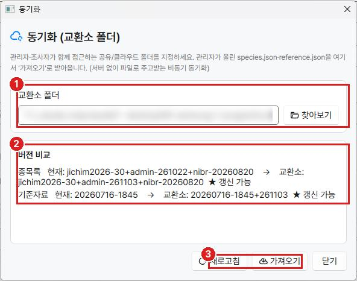

| 번호 | 설명 |
|---|---|
| ① | 「교환소 폴더」 칸 · [찾아보기] |
| ② | 「버전 비교」 — 종목록 · 기준자료의 현재 판 → 교환소 판 · 「★ 갱신 가능」 |
| ③ | [새로고침] · [가져오기] |

| 기능 | 설명 |
|---|---|
| 「현재」 | 교체본 파일이 있으면 그 판 · 없으면 기본본 판(종목록을 실제로 쓰는 판은 정보 창에서 확인) |
| 「★ 갱신 가능」 | 판 글자가 다르면 붙음 — 교환소 판이 더 오래돼도 붙음 |
| [가져오기] | 두 파일을 `%AppData%\SDSM_Surveyor\` 로 복사 · 교환소에 둘 다 없으면 꺼짐 |

1. 캡션 바 [동기화] 를 누릅니다.
2. 「교환소 폴더」 에 관리자와 정한 폴더를 넣습니다([찾아보기]).
3. 「버전 비교」 에서 교환소 판을 확인하고 [가져오기] 를 누릅니다.
4. 「{n}개 파일을 가져왔습니다. 앱을 다시 시작하면 반영됩니다.」 를 보고 앱을 다시 실행합니다.

- 지점 목록(→ 9.2) · 지도(→ 3.6) · 조사 자료 올리기는 동기화에 없습니다. 자료는 자료함 [내보내기] (→ 7.6) · 엑셀(→ 8장)로 넘깁니다.

> ⚠ [가져오기] 는 묻지 않고 교체본을 덮어씁니다. 되돌리려면 `%AppData%\SDSM_Surveyor\` 의 그 파일을 지우거나 옮기고 다시 시작합니다(기본본으로 돌아감).

# 10. 프로그램 정보

캡션 바(또는 분류군 고르기 창) [정보] 를 누르면 [프로그램 정보] 창이 열립니다. 문의할 때는 판 · 종목록 판을 함께 알려 줍니다.

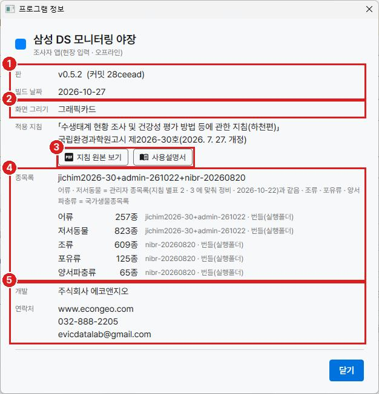

| 번호 | 설명 |
|---|---|
| ① | 「판」 · 「빌드 날짜」 |
| ② | 「화면 그리기」 |
| ③ | [지침 원본 보기] · [사용설명서] |
| ④ | 「종목록」 — 판 · 분류군별 종 수 · 출처 |
| ⑤ | 「개발」 · 「연락처」 |

| 줄 | 내용 |
|---|---|
| 「판」 · 「빌드 날짜」 | `v0.5.2` 와 괄호 안 커밋 번호 · 프로그램을 만든 날 |
| 「화면 그리기」 | 「그래픽카드」(보통) · 「소프트웨어(software_render 파일)」(실행 폴더에 `software_render` 파일이 있을 때 · → 11.1) |
| 「적용 지침」 | 「수생태계 현황 조사 및 건강성 평가 방법 등에 관한 지침(하천편)」 · 「국립환경과학원고시 제2026-30호(2026. 7. 27. 개정)」 |
| [지침 원본 보기] · [사용설명서] | 지침 원본 · 이 설명서 PDF 를 기본 PDF 프로그램으로 엶 |
| 「종목록」 | 종목록 판 · 분류군별 종 수 · 판 · 출처 |
| 「개발」 | 「주식회사 에코앤지오」 |
| 「연락처」 | 「www.econgeo.com · 032-888-2205 · evicdatalab@gmail.com」(화면에는 한 줄에 하나씩) |
| [닫기] | **Enter** · **Esc** 로도 닫힘 |

### 종목록 줄 보는 법

> 「어류 · 저서동물 = 관리자 종목록(지침 별표 2 · 3 에 맞춰 정비 · 2026-10-22)과 같음 · 조류 · 포유류 · 양서파충류 = 국가생물종목록」

- 판 예 `jichim2026-30+admin-261022+nibr-20260820` — `admin-…` 은 어류 · 저서, `nibr-…` 은 관찰형 판입니다.
- 프로그램에 든 목록 그대로면 어류 257종 · 저서동물 823종 · 조류 609종 · 포유류 125종 · 양서파충류 65종입니다.
- 종목록 판이 관리자와 같아야 지수(FAI · BMI)가 관리자 계산과 같습니다(→ 9.1).

| 출처 | 뜻 |
|---|---|
| 「번들(실행폴더)」 | 프로그램 폴더의 `species.json` |
| 「교체본(AppData)」 | [동기화] 로 받은 `species.json`(→ 9.1) |
| 「최소 시드」 | 종목록 파일을 읽지 못함 · 압축을 다시 풀거나 담당자에게 알림 |

### PDF 가 열리지 않을 때

까닭은 단추 아래에 나옵니다(캡션 바 [사용설명서] 는 알림 띠).

| 안내 | 조치 |
|---|---|
| 「지침 원본 파일을 찾지 못했습니다 — {경로}」 · 「사용설명서 파일이 없습니다 — 프로그램 폴더의 manual\surveyor_manual.pdf 를 확인하세요」 | 압축을 다시 풂 |
| 「PDF 를 여는 프로그램이 없어 열지 못했습니다({오류}) — 파일 위치: {경로}」 | PDF 보기 프로그램을 설치하거나 그 위치의 파일을 직접 엶 |

# 11. 문제 해결

## 11.1. 흰 화면 → software_render

어떤 PC 에서는 그래픽카드로 화면을 그리지 못해, 창은 뜨지만 안이 모두 흰색(캡션 바 · 글자 · 단추 없음)으로만 보일 수 있습니다. 프로그램이나 자료가 망가진 것은 아니며, 화면을 소프트웨어로 그리게 바꾸면 됩니다.

새로 푼 프로그램은 처음 실행할 때 창이 뜨기까지 10초 넘게 걸릴 수 있습니다 — 창이 아예 안 뜨면 잠시 기다립니다.

1. 흰 창을 닫습니다(오른쪽 위 닫기).
2. 탐색기로 프로그램 폴더(`SDSM_Surveyor_App.exe` 가 있는 폴더)를 엽니다.
3. 빈 곳을 오른쪽 단추로 눌러 새로 만들기 → 텍스트 문서를 고르고, 이름을 `software_render` 로 합니다(`software_render.txt` 가 되어도 됨 · 내용은 비워 둠).
4. 프로그램을 다시 실행합니다.
5. [정보] 창 「화면 그리기」 줄이 「소프트웨어(software_render 파일)」 인지 확인합니다(평소 「그래픽카드」 · {{그림 info}}).

| 기능 | 설명 |
|---|---|
| 켜지는 이름 | 확장자를 모두 뗀 이름이 `software_render` 인 파일(대소문자 · 확장자 · 내용 무관) — `software_render_old.txt` 처럼 이름이 다르거나 폴더면 안 켜짐 |
| 두는 곳 | 프로그램 폴더 바로 아래 — 하위 폴더나 `%AppData%` 에 두면 안 켜짐 · 새 판을 다른 폴더에 풀면 다시 만듦 |
| 되돌리기 | 파일을 지우거나 이름을 바꾸고 다시 실행 |

- 소프트웨어로 그려도 입력 · 저장 · 내보내기는 똑같습니다.
- 그래도 흰 화면이면 파일 이름과 자리를 다시 확인하고 담당자에게 알립니다(연락처 → 10장).

## 11.2. 오류 창 · 오류 기록 위치 · 복구본

예기치 않은 오류가 나면 앱이 오류 기록을 남기고, 화면에 분류군 자료가 있으면 복구본을 만든 뒤 「오류 — 삼성 DS 모니터링 야장」 창을 띄웁니다.

| 창의 줄 | 뜻 |
|---|---|
| 「프로그램은 닫지 않았습니다. 지금 화면의 입력은 그대로 있습니다.」 | 계속 쓸 수 있음(이 줄이 없으면 곧 닫힐 수 있음) |
| 「오류 기록 : {경로}」 | 오류 기록 파일 |
| 「지금 화면 임시 저장 : {경로}」 | 복구본 — 자료함의 정식 자료는 덮지 않음 |
| 「화면에 입력한 분류군 자료가 없어 임시 저장은 하지 않았습니다.」 | 복구본 없음 |

1. [확인] 을 누르고, 프로그램이 열려 있으면 바로 [임시 저장] 을 누릅니다.
2. 무엇을 하다가 났는지 적어 오류 기록 파일과 함께 담당자에게 보냅니다(연락처 → 10장).
3. 같은 오류가 되풀이되면 프로그램을 다시 시작합니다.

| 기능 | 설명 |
|---|---|
| 오류 기록 | `%AppData%\SDSM_Surveyor\sessions\logs\error_yyMMdd.log` — 날마다 한 파일 · 시각 · 판 · 오류 내용 |
| 복구본 | `%AppData%\SDSM_Surveyor\sessions\_recovery\` — 다음 실행 때 「복구본이 있습니다」 창 [불러오기] · [나중에] ({{그림 recovery}} · → 7.7) |

> ⚠ 복구본은 [불러오기] 만으로는 자료함에 들어가지 않습니다. 화면을 확인한 뒤 [임시 저장] 을 누르고, 같은 자료가 있으면 [합치기] 를 고릅니다(→ 7.2).

## 11.3. 자주 묻는 질문

| 질문 | 답 |
|---|---|
| [일괄입력용] 을 눌러도 파일이 안 생깁니다 | 상태 바 「일괄입력용을 만들지 않았습니다 — …」 뒤에 막은 칸이 나옵니다. 그 칸을 고칩니다(→ 8.4). [보고서 엑셀] 은 막지 않습니다 |
| 「과거 기록 없음 (신규 종 확인)」 이 자주 뜹니다 | 이상치 기준에 없는 종이면 뜹니다. 경고일 뿐 막지 않습니다(→ 6.4 · 9.3) |
| FAI 가 '-' 이고 「하천차수 필요」 가 보입니다 | 어류 조사환경 「하천차수」 에 값을 넣습니다(→ 4.1) |
| 조사불가인데 등급이 나옵니다 | 어류 「조사불가 사유」 · 저서 「채집불가시(사유)」 는 네 낱말(접근불가 · 건천화 · 준설 · 공사중) 중 하나를 고릅니다. 서식수변 「조사불가시」 는 글에 `접근불가` 가 들어 있어야 합니다 |
| 「저장하지 못했습니다. 같은 이름 파일이 엑셀에 열려 있는지, 저장 위치가 살아 있는지 확인해 주세요.」 | 같은 이름 엑셀 파일을 닫고 다시 저장합니다 |
| 붙여넣었더니 「국명」 이라는 종 행이 생겼습니다 | 머리글 줄까지 복사한 것입니다. 그 행을 [행 삭제] 하고 머리글을 빼고 복사합니다 |
| 지도에 위치 점이 안 나옵니다 | 지도 창 위 안내 글이 까닭입니다 — 좌표 없음 · 보정 없음([지도 관리] → 3.6) · 지도 범위 밖 |
| 켤 때마다 분류군 고르기 창이 뜹니다 | 「다음 실행에도 {분류군}로 시작」 을 켜고 들어갑니다 |
| 검출한계 미만(ND · <0.5)은 어디에 적나요 | 측정 칸은 비우고 「비고(특이사항)」 에 적습니다(→ 5.2) |
| 화면 아래 알림이 금방 사라집니다 | 알림 띠는 성공 4초 · 주의 8초 뒤 사라지고 [×] 로 바로 닫습니다. 마우스를 올리면 전체 글이 보입니다 |
| 「사용설명서 파일이 없습니다 — …」 가 뜹니다 | 프로그램 폴더에 `manual\surveyor_manual.pdf` 가 없습니다. 받은 압축을 폴더째 다시 풉니다 |
| 새 판으로 바꾸면 자료가 사라지나요 | 아니요. 자료는 `%AppData%\SDSM_Surveyor\` 에 있어 그대로입니다(→ 1.5) |
| 다른 PC 로 자료를 옮기려면 | 자료함 [내보내기] 로 zip 을 만들어 다른 PC 자료함에서 [가져오기] 합니다(→ 7.6) |
| [출현종 없음(0종)] 을 켰는데 FAI 가 '-' 이고 「하천차수 필요」 가 뜹니다 | 종 행이 있으면 0종 선언을 쓰지 않습니다. 정말 0종이면 종 행을 지우고, 종이 있으면 [출현종 없음(0종)] 을 끄고 「하천차수」 를 넣습니다(→ 4.0) |
| 차수 · 지점을 고쳐 저장했더니 창이 묻습니다 | 「세션 이름이 바뀌었습니다」 창입니다. 원래 세션을 남기려면 [새 세션으로 저장](기본)을 누릅니다(→ 7.1) |

# 부록 A. 키 동작

앱 전체에 걸린 단축키(예: **Ctrl+S** 로 저장)는 없습니다. 아래 키는 그 창 · 그 칸에서만 동작합니다.

### 확인 창

**Enter** = 강조색 기본 단추 · **Esc** 또는 창 닫기(×) = 취소 몫 단추입니다.

| 확인 창 | Enter(기본) | Esc |
|---|---|---|
| 「저장 확인」 | [예] | [취소] |
| 「같은 자료가 이미 있습니다」 | [합치기] | [취소] |
| 「세션 이름이 바뀌었습니다」 | [새 세션으로 저장] | [취소] |
| 「지점 변경」 | [지점명만 고침(유지)] | [취소(바꾸지 않음)] |
| 「목록 밖 지점」 | [예] | [아니요] |
| 「복구본이 있습니다」 | [불러오기] | [나중에] |
| 「행 삭제」 | [취소] — Enter 로 지워지지 않음 | [취소] |
| 「세션 삭제」 · 「지도 삭제」 | [취소] — Enter 로 지워지지 않음 | [취소] |
| 「저장 완료」 | [파일 열기] | [닫기] |

> 지우는 확인 창(「행 삭제」 · 「세션 삭제」 · 「지도 삭제」)은 모두 [취소] 가 기본입니다. 지우려면 [확인] 을 누릅니다.

### 창 · 조사개황

| 곳 | 키 | 동작 |
|---|---|---|
| 분류군 고르기 창 | **Enter** | [어류 야장 열기] (어류 자리에 고른 분류군) |
| 정보 창 | **Enter** · **Esc** | [닫기] (다른 창은 **Esc** 로 닫히지 않음 — [닫기]) |
| 자료함 창 | 두 번 누르기 · **Ctrl** · **Shift** + 누르기 | [불러오기] · 세션 여러 개 고르기 |
| 지도 창 · 지도 관리 창 | 휠 · 끌기 | 확대 · 축소 / 옮기기 |
| 지점 칸 | **↓** · **↑** · **PageDown** · **PageUp** | 친 글자로 거른 후보를 펼치고 강조 이동(Page = 5칸) |
| 지점 칸 | **Enter** · **Tab** | 똑같은 이름(St.번호 포함)이나 강조한 후보만 확정(→ 3.2) |
| 지점 칸 | **Esc** | 후보 목록만 닫음(친 글자는 남김) |

### 종 입력 · 입력 칸

| 곳 | 키 | 동작 |
|---|---|---|
| 빠른추가 검색 칸 | **↓** · **↑** · **Enter** | 후보 고르기(**Enter** 는 이름이 똑같은 종만) → 개체수 칸으로 |
| 빠른추가 개체수 칸 | **Enter** | 행 추가 → 검색 칸으로 돌아감 |
| 종 그리드 | **Ctrl+V** · **Ctrl+C** · **F2** | 엑셀 여러 줄 붙여넣기(→ 4.0) · 칸 복사 · 칸 고치기 |
| 종 그리드 국명 칸 | **Enter** | 똑같은 이름이나 고른 후보 → 그 종 · 그 밖은 친 글자 그대로(목록 밖 종) |
| 종 그리드 | 방향키 · **Tab** 등으로 칸 옮기기 | [행 삭제] 대상이 풀림 — 지울 행을 다시 누름 |
| 정수 · 소수 칸 | 받지 않는 글자 | 안내(약 2.5초) 동안 이어 치는 글자도 막힘 — **Backspace** · 방향키 · **Tab** 으로 풀림 |
| 여러 개 고르기 칸 | **Enter** | 「그 밖의 값 입력 후 Enter」 칸의 값을 항목으로 더함 |
| 서식수변 점수 칸 | 숫자 키 · **Delete** | 그 점수를 바로 고름(`1` 다음 `0` = 10점) · 점수 비움 |
| 열린 목록 · 닫힌 고르기 칸 | 휠 | 목록만 움직임 · 값은 바뀌지 않고 화면이 움직임 |

# 부록 B. 분류군별 입력 항목과 조사표 대응

- 기준: 어류 · 저서동물 · 서식수변은 지침 서식 3 · 2 · 7, 조류 · 포유류 · 양서파충류 · 수질은 2026-03 일괄입력 양식입니다. 칸은 엑셀 주소입니다.
- 조사일은 분류군 「조사일」(비면 조사개황 「조사일자」)이 `yyyyMMdd` 로 나갑니다. 조사개황 칸은 3장.

## B.1. 어류

지침 서식 3 → `어류_입력` 시트 Q열 · 종은 79행부터.

| 조사표 항목 | 앱 칸 | 일괄입력용 |
|---|---|---|
| 지점 · 하천 · 경위도 · 조사일 · 기상 · 조사자 등 | 조사개황 · 「조사일」 | Q2~Q13 |
| 채집소요시간 · 조사도구 | 「채집소요시간(분)」 · 「채집도구」 | Q14 · Q15 |
| 흐름 유형 | 「흐름상태(채집)」 | Q16 |
| (없음) | 「하천차수」 | Q17 |
| 하상구조 8칸 | 「암반 (B)」 ~ 「큰돌 (BS)」 | Q18~Q25 |
| 하천 형태 · 흐름 상태 | 「하천형태」 · 「흐름상태(유속)」 | Q27 · Q28 |
| 채집 불가 · 채집 가능 | 「조사불가 사유」 · 「비고」 | Q29 · Q30 |
| 비정상 개체수 | 「DE 개체수」 ~ 「TU 개체수」 | Q44~Q47 |
| 종명 · 개체수 | 「국명」 · 「개체수」 | 79행~ N · Q |

- 없는 것: 분류번호 · 행정구역명 · 하천유형 일반/대하천 · 종별 비정상 유형 · 'DB 종목록 미포함 종' 칸(목록 밖 종으로 입력).

## B.2. 저서동물

지침 서식 2 → `입력` 시트 M열 · 종은 47행부터.

| 조사표 항목 | 앱 칸 | 일괄입력용 |
|---|---|---|
| 조사지명 · 조사일 · 날씨 · 경위도 · 조사자 등 | 조사개황 · 「조사일」 | M2~M13 |
| 조사도구 · 횟수 | 「Surber 30×30 (회)」 · 「Surber 50×50 (회)」 · 「드렛지/D-Net (회)」 · 「에크만 (회)」 | M14~M17 |
| 유역이용 · 유입오염원 · 수피도 · 범람원 | 「유역이용」 · 「확인 가능 오염원」 · 「식생 수피도」 · 「범람원의 이용」 | M18~M21 |
| 제방 좌안 · 우안 | 「제방(좌안)」 · 「제방(우안)」 | M22 · M23 |
| 하상기질 6칸 | 「서식지 하상구성 (%) — 합계 100」 | M26~M31 |
| 하천유형 | 「하천유형(서식처)」 | M33 |
| 평균하폭 · 수폭 · 수심 · 유속 | 「하폭(m)」 · 「수폭(m)」 · 「평균수심(cm)」 · 「평균유속(cm/s)」 | M34~M37 |
| 기온 · 수온 | 「기온(℃)」 · 「수온(℃)」 | M38 · M39 |
| 서식처 · 투명도 · 냄새 | 「흐름상태」 · 「투명도」 · 「냄새」 | M40~M42 |
| 채집가능시 · 채집불가시 | 「특이사항(비고)」 · 「채집불가시(사유)」 | M43 · M44 |
| 종 자료 | 「국명」 · 「개체수」(소수) | 47행~ M |

- 없는 것: 구조물 · 식생 교목/관목/초본 % · 수심차 · 서식처 여울/흐름/소 비율 · 끈벌레 · 채집가능시 선택지 · 제방 '수직'.

## B.3. 조류

`조류` 시트 · 5행부터 1행 = 1기록.

| 양식 항목 | 앱 칸 | 열 |
|---|---|---|
| 연도/차수 · 조사일 · 날씨 · 하천명 · 지점명 | 조사개황 · 「조사일」 | B~F |
| 일반명 · 학명 · 특징 | 「일반명」 · 「학명」 · 「특징」 | G · H · I |
| 위도 · 경도 | 「위도」 · 「경도」 | P · Q |
| 개체수 · 도래유형 | 「개체수」 · 「도래유형」(코드) | S · T |
| 대항목 · 세부 항목 · 서식 유형 | 「대항목」 · 「세부항목」 · 「서식유형」 | U · V · W |
| 조사자 · 특이사항 | 「조사자」 · 「특이사항」 | X · Y |

- 없는 것: 좌표 도분초(J~O). 앱 「구분」은 I열로 나가지 않습니다(「특징」 글만).

## B.4. 포유류

`포유류` 시트 · 5행부터.

| 양식 항목 | 앱 칸 | 열 |
|---|---|---|
| 연도/차수 · 조사일 · 날씨 · 하천명 · 지점명 | 조사개황 · 「조사일」 | B~F |
| 일반명 · 학명 · 특징 | 「일반명」 · 「학명」 · 「특징」 | G · H · I |
| 위도 · 경도 | 「위도」 · 「경도」 | P · Q |
| 관찰지 유형 | 「관찰지유형」(자유 글) | S |
| 흔적 유형 12 | 「포획」 ~ 「기타」(화면 순서) | T~AE |
| 조사자 · 특이사항 | 「조사자」 · 「특이사항」 | AF · AG |

- 없는 것: 좌표 도분초(J~O).

## B.5. 양서파충류

`양서파충류` 시트 · 5행부터.

| 양식 항목 | 앱 칸 | 열 |
|---|---|---|
| 연도/차수 · 조사일 · 날씨 · 하천명 · 지점명 | 조사개황 · 「조사일」 | B~F |
| 일반명 · 학명 · 특징 | 「일반명」 · 「학명」 · 「특징」 | G · H · I |
| 관찰내용 6 | 「성체」 ~ 「기타」(화면 순서) | J~O |
| 위도 · 경도 | 「위도」 · 「경도」 | V · W |
| 서식지 유형 대분류 · 중분류 | 「대분류」 · 「중분류」 | Y · Z |
| 조사자 · 특이사항 | 「조사자」 · 「특이사항」 | AA · AB |

- 없는 것: 좌표 도분초(P~U).

## B.6. 서식수변

지침 서식 7 → `서식 및 수변환경` 시트 F열.

| 조사표 항목 | 앱 칸 | 일괄입력용 |
|---|---|---|
| 조사일시 · 지점 · 하천 · 경위도 · 조사자 등 | 조사개황 · 「조사일」 | F2~F13 |
| 조사불가 · 조사가능 특이사항 | 「조사불가시」 · 「비고」 | F14 · F15 |
| 평가항목 1~10 | 「1. 자연적 종횡사주」 ~ 「10. 제내지 토지 이용」(좌 · 우는 평균) | F17~F26 |
| 총점 및 등급 | 자동(앱은 쓰지 않음) | 27~29행 수식 |

- 없는 것: 고도 · 종횡사주 · 유속 발생 횟수 · 하천변 폭 실측 · 저질 구성비 · 횡구조물 위치.

## B.7. 수질

`수질` 시트 F열.

| 양식 항목 | 앱 칸 | 일괄입력용 |
|---|---|---|
| 연도/차수 ~ 조사자(12칸) | 조사개황 · 「조사일」 | F2~F13 |
| pH · BOD · COD · TOC · SS · DO · T-P | 「pH」 ~ 「T-P (mg/L)」 | F14~F20 |
| 생태독성 · 대장균군 | 「생태독성 (TU)」 · 「대장균군 (군수/100mL)」 | F21 · F22 |
| 추가항목 1~5 | 「T-N (mg/L)」 · 「전기전도도 (µS/cm)」 · 「구리 Cu (mg/L)」 · 「아연 Zn (mg/L)」 · 「크롬 Cr (mg/L)」 | F23~F27 |
| 추가항목 6~9 | 「염소이온 (mg/L)」 · 「황이온 (mg/L)」 · 「탁도 (NTU)」 · 「클로로필a (mg/m³)」 | F28~F31 |
| 추가항목 10~13 | 「수온 (℃)」 · 「유속 (cm/s)」 · 「초당유량 (m³/sec)」 · 「일당유량 (m³/day)」 | F32~F35 |
| (없음) | 「수심 (cm)」 | 37행 덧붙임 |
| (없음) | 「비고(특이사항)」 | 나가지 않음 |

- 없는 것: 없음. 수질 등급(38~45행)은 양식 수식입니다.

# 부록 C. 저장 위치 · 파일 이름

### 사용자 자료 — `%AppData%\SDSM_Surveyor\`

`C:\Users\<사용자>\AppData\Roaming\SDSM_Surveyor\` 와 같은 곳입니다(탐색기 주소 칸에 `%AppData%\SDSM_Surveyor` 를 치고 **Enter**). 프로그램 폴더를 바꾸거나 지워도 남습니다.

| 위치 | 내용 |
|---|---|
| `sessions\{대분류}_{연도차수}_{지점}.json` · `index.json` | 자료함 세션(빈 칸은 `무제`) · 목록 |
| `sessions\_recovery\` | 복구본(→ 11.2) · 불러온 것은 `loaded\` |
| `sessions\logs\error_yyMMdd.log` | 오류 기록(→ 11.2) |
| `settings.json` | 담당 분류군 · 「다음 실행에도 …」 · 압정 6칸 · 교환소 폴더 |
| `species.json` · `sites.json` · `reference.json` | 기준자료 교체본(→ 9장) |
| `maps\` | 지도 — 첫 실행에 프로그램 폴더에서 복사 · [지도 관리] 는 여기만 고침 |

> ⚠ 이 폴더는 조사 자료 원본입니다. 지우거나 옮기지 않습니다. 지켜 두려면 폴더를 통째로 복사합니다(→ 1.4).

### 프로그램 폴더 — 압축을 푼 `SDSM_Surveyor_v0.5.2\`

| 위치 | 내용 |
|---|---|
| `SDSM_Surveyor_App.exe` | 프로그램(.NET 따로 설치하지 않음) |
| `species.json` · `sites.json` · `reference.json` · `maps\` | 기준자료 · 지도 29장 기본본 |
| `guideline\guideline_2026-30.pdf` · `manual\surveyor_manual.pdf` | 지침 원본([지침 원본 보기]) · 이 사용설명서([사용설명서]) |
| `templates\bulk\` | 일괄입력용 양식 — 없으면 「저장 중단」 |
| `software_render` | 직접 만든 경우만 — 흰 화면 대비(→ 11.1) |
| 그 밖의 파일(`.dll` 등) | 실행에 필요 — 지우지 않음 |

### 내보내기 파일 이름

| 내보내기 | 기본 파일 이름 |
|---|---|
| [보고서 엑셀] | `{대분류}_{연도차수}_{지점}_{분류군}_조사결과.xlsx` |
| [일괄입력용] · [일괄입력용 일괄] | `{대분류}_{연도차수}_{지점}_{분류군}_DB_v1.xlsx` — 일괄은 고른 폴더 바로 아래 · 겹치면 `(2)` |
| [보고서 일괄(한 파일)] | `일괄_{대분류}_{연도차수}_조사결과.xlsx` — 연도차수는 모두 같을 때만 |
| 종목록 창 [엑셀로 저장] | `종목록_{분류군}_{판}.xlsx` |
| 자료함 [내보내기] | `자료함_yyyyMMdd_HHmm_{n}건.zip` |

- 예: `방류하천_2026반기2차_곡교천1_어류_DB_v1.xlsx`. `{분류군}` = 어류 · 저서동물 · 조류 · 포유류 · 양서파충류 · 서식수변 · 수질.
- 빈 칸은 이름에서 빠지고, 파일 이름에 못 쓰는 글자는 `_` 로 바뀝니다. 생태현황에서 지점명 없이 하천명만 적으면 `{지점}` 자리가 `{하천명}(지점명 없음)` 입니다.
- 저장 · 폴더 고르기 창은 지난번에 내보낸 폴더(이 PC 의 로컬 드라이브일 때)에서 열리고, 처음이거나 그 폴더가 없으면 '문서' 에서 열립니다. 네트워크 드라이브 · OneDrive 폴더에서는 열지 않습니다(그 폴더를 읽느라 창이 멈추는 일을 막음).

# 부록 D. 용어

| 용어 | 뜻 |
|---|---|
| 세션 | 대분류 · 연도차수 · 지점 하나의 자료 묶음 — 조사개황 + 7개 분류군. [임시 저장] 은 세션 전체를 저장(→ 7.1) |
| 자료함 | 세션을 모아 두는 곳(`%AppData%\SDSM_Surveyor\sessions\`) · 캡션 바 [자료함] (→ 7장) |
| 분류군 | 어류 · 저서동물 · 조류 · 포유류 · 양서파충류 · 수질 · 서식수변. 담당 분류군 = 지금 보이는 하나 — 바꿔도 다른 분류군 자료는 남음(→ 2.2) |
| 조사개황 | 대분류 · 연도차수 · 조사일자 · 지점명 · 좌표 · 조사자 등 세션 공통 칸 — 7개 분류군이 함께 씀(→ 3장) |
| 압정 | 조사개황 6칸 옆 고정 단추 — 켜면 앱을 다시 켤 때 그 값이 들어감(→ 3.3) |
| 일괄입력용 | 관리자 일괄등록에 넣는 엑셀(`…_DB_v1.xlsx`) — 관리자가 못 읽는 값이 있으면 만들지 않음 · [일괄입력용] (→ 8장) |
| 보고서용 | 보고 · 보관용 엑셀(`…_조사결과.xlsx`) — 조사개황 · 출현종 · 지수 시트 · [보고서 엑셀] (→ 8장) |
| 목록 밖 종 | 종목록에 없는 국명 — 그리드 새 행 · 붙여넣기로만 넣음 · 지우지 않고 경고 · 어류 길드 항목 · BMI 계산에서 빠짐(→ 4.0) |
| 이상치 | 과거 최대보다 많거나 기록이 없는 종의 개체수 — 경고만 하고 막지 않음(→ 6.4) |
| 알림 띠 | 상태 바 바로 위 한 줄 알림 — 성공 4초 · 주의 8초 뒤 사라짐 · [×] 로 닫음(→ 2.3) |
| 교체본 · 기본본 | 기준자료의 두 자리 — `%AppData%\SDSM_Surveyor\` · 프로그램 폴더(→ 9장) |
| 복구본 | 오류 때 화면 입력을 따로 남긴 파일(→ 7.7 · 11.2) |
| FAI | 어류평가지수 — M1~M8 여덟 항목 점수 합 0~100점 · 등급 A~E · 하천차수가 있어야 계산(→ 4.1) |
| BMI | 저서동물지수 — 오탁치 s · 지표가중치 g · 순위점수 h 로 (4 − Σ(s·g·h) / Σ(g·h)) × 25 · 등급 A~E(→ 4.2) |
| HRI | 서식 및 수변환경 평가지수(화면 「서식·수변환경 평가」) — 10항목 점수 합 ÷ 2 · 등급 A~E(→ 5.1) |
| DI · H′ · R1 · J′ | 저서동물 다양도 지수(→ 4.2) — 우점도 DI = 상위 두 종 개체수 ÷ 전체 · 다양도 H′(화면 「다양도 H'」) = 섀넌 다양도 · 풍부도 R1 = (종 수 − 1) ÷ ln(전체 개체수) · 균등도 J′(화면 「균등도 J'」) = H′ ÷ log₂(종 수) |
